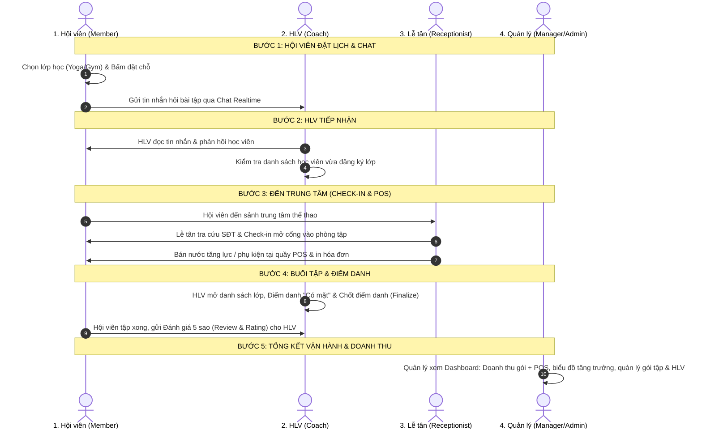

# 🏆 KỊCH BẢN DEMO HỆ THỐNG SPORT CENTER (SMARTGYM OS)
> **Tài liệu hướng dẫn bảo vệ đồ án dành cho Hội đồng / Giảng viên**  
> *Được thiết kế theo chu trình nghiệp vụ khép kín (End-to-End Lifecycle) từ Hội viên ➔ Huấn luyện viên ➔ Lễ tân ➔ Quản trị viên.*

---

## 🔑 1. DANH SÁCH TÀI KHOẢN DEMO THEO ROLE

Tất cả các tài khoản dưới đây đã được cấu hình và xác thực đăng nhập thành công với cơ sở dữ liệu Supabase:

| Vai trò (Role) | Email đăng nhập | Mật khẩu chung | Tên người dùng | Đường dẫn Portal |
| :--- | :--- | :---: | :--- | :--- |
| **1. Hội viên (Member)** | `hoxuananhnam@gmail.com` | **`123456`** | Ho Xuan Anh Nam | `http://localhost:5173/#member` |
| **2. Huấn luyện viên (Coach)** | `hoxuananhnam1@gmail.com` | **`123456`** | Ho Xuan Anh Nam | `http://localhost:5173/#coach-portal` |
| **3. Lễ tân (Receptionist)** | `receptionist01@smartgym.com` | **`123456`** | Nguyễn Văn Lễ Tân | `http://localhost:5173/#receptionist` |
| **4. Quản lý (Manager / Admin)** | `manager@test.com` | **`123456`** | Manager Test | `http://localhost:5173/#dashboard` |

> [!TIP]
> **Ghi nhớ nhanh:** Cả 4 tài khoản đều dùng chung **mật khẩu duy nhất: `123456`**.

---

## 🔄 2. SƠ ĐỒ LUỒNG TỔNG QUAN (BUSINESS LIFECYCLE)

---

## 🎬 3. KỊCH BẢN THUYẾT TRÌNH CHI TIẾT (5 PHÂN CẢNH)

> [!IMPORTANT]
> **Bí quyết thao tác mượt mà:**
> - Mở **Chrome thường**: Đăng nhập sẵn tài khoản **Member**.
> - Mở **Edge (hoặc Cửa sổ ẩn danh Incognito)**: Dùng để chuyển đổi giữa **Coach ➔ Lễ tân ➔ Admin**.  
> Việc này giúp bạn không phải đăng xuất/đăng nhập lại nhiều lần, tiết kiệm tối đa thời gian.

---

### PHÂN CẢNH 1: HỘI VIÊN TƯƠNG TÁC & ĐẶT LỊCH (Role Member)
* **Tài khoản:** `hoxuananhnam@gmail.com` | Mật khẩu: `123456`
* **Mục tiêu:** Tạo dữ liệu đầu vào cho Huấn luyện viên và Lễ tân.

1. **Lời dẫn:** 
   > *"Kính thưa thầy/cô, đầu tiên học viên Nam mở ứng dụng hội viên để theo dõi tiến độ tập luyện và đặt chỗ lớp học cho ngày hôm nay."*
2. **Thao tác trên màn hình:**
   * **Dashboard:** Chỉ vào Thẻ hội viên điện tử, gói tập còn hạn, số buổi tập đã hoàn thành.
   * **Đặt lịch lớp học:**
     * Bấm tab **Lớp học (Classes)**.
     * Chọn 1 lớp học sắp diễn ra (Yoga / Gym do HLV Ho Xuan Anh Nam phụ trách).
     * Bấm **Đặt lịch (Book Now)** ➔ Hệ thống hiển thị thông báo thành công, số lượng chỗ trống tự động trừ 1.
     * Chuyển sang tab **Lịch tập (Schedule)**: Chứng minh lớp vừa đặt đã xuất hiện ngay ngắn trong lịch cá nhân.
   * **Ví điện tử & Cửa hàng (Shop):**
     * Mở mục **Ví (Wallet)**: Xem số dư ví.
     * Mở mục **Cửa hàng (Shop)**: Xem danh mục nước uống, thực phẩm bổ sung.
   * **Chat trực tuyến:** 
     * Vào mục **Chat**: Gửi 1 tin nhắn cho HLV: *"Thầy ơi hôm nay em đến lớp đúng giờ nhé!"*.

---

### PHÂN CẢNH 2: HUẤN LUYỆN VIÊN TIẾP NHẬN & CHUẨN BỊ (Role Coach)
* **Tài khoản:** `hoxuananhnam1@gmail.com` | Mật khẩu: `123456`
* **Mục tiêu:** Chứng minh tính đồng bộ dữ liệu Realtime từ Member sang Coach.

1. **Lời dẫn:** 
   > *"Về phía Huấn luyện viên, thầy Nam mở portal HLV để kiểm tra lịch dạy, tương tác với học viên và chuẩn bị giáo án."*
2. **Thao tác trên màn hình:**
   * **Tương tác Chat:**
     * Mở mục **Chat**: Thấy ngay tin nhắn học viên Nam vừa gửi từ Phân cảnh 1.
     * Gửi tin phản hồi: *"Chào Nam, nhớ khởi động kỹ trước giờ tập nhé"*.
   * **Kiểm tra lớp học & Sĩ số:**
     * Vào mục **Điểm danh (Attendance)** hoặc **Chi tiết lớp học**.
     * Chọn lớp học vừa được đặt ở Phân cảnh 1.
     * **Điểm ăn tiền:** Tên học viên `Ho Xuan Anh Nam` đã xuất hiện trong danh sách học viên với trạng thái *"Chưa điểm danh"*.
   * **Tính năng cảnh báo xung đột lịch (Conflict Detection):**
     * Chỉ cho giảng viên thấy hệ thống tự động ngăn chặn nếu HLV bị trùng lịch giữa ca dạy nhóm và ca kèm riêng 1:1.

---

### PHÂN CẢNH 3: TIẾP ĐÓN TẠI QUẦY – CHECK-IN & POS (Role Receptionist)
* **Tài khoản:** `receptionist01@smartgym.com` | Mật khẩu: `123456`
* **Mục tiêu:** Mô phỏng quy trình đón khách và bán lẻ tại sảnh trung tâm.

1. **Lời dẫn:** 
   > *"Đến giờ tập, học viên Nam đến trung tâm. Lễ tân tại quầy sẽ kiểm tra thẻ và làm thủ tục check-in vào cửa."*
2. **Thao tác trên màn hình:**
   * **Quầy Check-in tự động:**
     * Vào tab **Check-in**: Nhập số điện thoại của Nam (`0989123788`) hoặc tra cứu tên.
     * Hệ thống xác thực gói tập hợp lệ ➔ Bấm **Xác nhận Check-in** (Cổng mở).
   * **Bán lẻ tại quầy (POS):**
     * Lời dẫn: *"Trước khi vào phòng tập, học viên Nam ghé quầy mua 1 chai nước Redbull."*
     * Vào tab **POS (Bán lẻ)**: Chọn sản phẩm *Nước tăng lực Redbull (25.000đ)* ➔ Bấm **Thanh toán & Xuất hoá đơn**.
   * **Đăng ký khách mới (Walk-in):**
     * Giới thiệu nhanh form đăng ký thẻ tập trực tiếp cho khách vãng lai không dùng điện thoại.

---

### PHÂN CẢNH 4: BUỔI HỌC DIỄN RA & ĐÁNH GIÁ (Coach ➔ Member)
* **Mục tiêu:** Hoàn tất buổi học và thể hiện tính năng Đánh giá chất lượng 2 chiều.

1. **Tại Cổng HLV (`hoxuananhnam1@gmail.com`):**
   * **Lời dẫn:** *"Lớp học bắt đầu, HLV tiến hành điểm danh thực tế."*
   * Mở mục **Điểm danh (Attendance)**:
     * Tích chọn học viên `Ho Xuan Anh Nam`: Chọn trạng thái **"Có mặt" (Present)**.
     * Điền ghi chú: *"Tập luyện rất tích cực, đạt mục tiêu buổi tập"*.
     * Bấm **Chốt điểm danh (Finalize)** ➔ Buổi học chính thức được lưu trữ vào lịch sử.

2. **Tại Cổng Hội viên (`hoxuananhnam@gmail.com`):**
   * **Lời dẫn:** *"Sau khi buổi tập kết thúc, học viên Nam vào ứng dụng để chấm điểm và đánh giá HLV."*
   * Vào mục **Đánh giá (Reviews)**:
     * Chọn HLV Ho Xuan Anh Nam.
     * Chấm **5 sao**, viết cảm nhận: *"HLV chỉ dẫn rất tận tâm, phòng tập sạch sẽ và thoáng mát!"*.
     * Bấm **Gửi đánh giá** ➔ Điểm sao trung bình của HLV được cập nhật ngay lập tức.

---

### PHÂN CẢNH 5: BÁO CÁO TOÀN DIỆN CHO BAN QUẢN LÝ (Role Manager / Admin)
* **Tài khoản:** `manager@test.com` | Mật khẩu: `123456`
* **Mục tiêu:** Chốt lại buổi demo ở góc độ quản trị điều hành doanh nghiệp.

1. **Lời dẫn:** 
   > *"Vào cuối ngày, Quản lý trung tâm mở Admin Dashboard để theo dõi các chỉ số tài chính và hoạt động vận hành."*
2. **Thao tác trên màn hình:**
   * **Báo cáo Doanh thu & Tài chính:**
     * Chỉ vào biểu đồ doanh thu: Doanh thu từ tiền bán gói tập + Tiền chai nước Redbull bán tại quầy POS ở Phân cảnh 3 đều đã được ghi nhận vào tổng doanh thu.
     * Thống kê tỷ lệ lấp đầy phòng tập và số lượng hội viên mới.
   * **Quản lý Vận hành:**
     * Xem danh sách Hội viên & Huấn luyện viên (xem được đánh giá 5 sao học viên vừa chấm).
     * Xem mục **Danh mục Gói tập (Package Catalog)**: Cấu hình gói tập (tên gói, giá, thời hạn, giới hạn môn).
     * Xem mục **Tồn kho sản phẩm (Inventory)**: Nước Redbull vừa bán đã tự động trừ 1 vào số lượng tồn kho.
3. **Lời kết:**
   > *"Kính thưa thầy/cô, đó là toàn bộ chu trình khép kín của nền tảng Sport Center. Hệ thống giúp số hóa 100% quy trình từ khâu bán gói, đặt lịch, vận hành tại sảnh cho đến báo cáo tài chính quản trị."*

---

## 💡 4. ĐIỂM SÁNG KỸ THUẬT NÊN NHẤN MẠNH KHI GIẢNG VIÊN HỎI

| Tiêu chí | Giải pháp công nghệ trong dự án |
| :--- | :--- |
| **Bảo mật & Phân quyền (RBAC)** | Phân quyền nghiêm ngặt theo **Role Claim** trong JWT Token (`manager`, `receptionist`, `coach`, `member`). Mỗi API Endpoint backend đều có Filter ủy quyền tương ứng. |
| **Ràng buộc nghiệp vụ (Validation)** | Kiểm tra **xung đột lịch dạy (Conflict Detection)** không cho phép 1 HLV dạy 2 lớp trùng giờ; Tự động đẩy vào **Waitlist** khi lớp học vượt quá sĩ số tối đa. |
| **Đồng bộ dữ liệu Realtime** | Hội viên vừa đặt lịch ➔ Danh sách học viên bên portal HLV hiển thị ngay lập tức; Hội viên vừa chat ➔ HLV nhận được tin nhắn hai chiều. |
| **Kiến trúc hệ thống (Clean Architecture)** | Backend xây dựng trên **.NET 10 Web API**, **Entity Framework Core**, cơ sở dữ liệu **Supabase PostgreSQL**; Frontend sử dụng **React + TypeScript + Tailwind CSS** chuẩn phong cách Glassmorphism. |

---

## 📌 5. CHECKLIST TRƯỚC GIỜ BÁO CÁO (5 PHÚT TRƯỚC KHI VÀO PHÒNG)

- [ ] Backend đã chạy lệnh: `dotnet run --project backend\SmartGym.Api` (Kiểm tra cổng `http://localhost:5000`)
- [ ] Frontend đã chạy lệnh: `npm run dev` (Kiểm tra cổng `http://localhost:5173`)
- [ ] Mở sẵn trình duyệt Chrome với tài khoản Member: `hoxuananhnam@gmail.com`
- [ ] Mở sẵn trình duyệt Edge (hoặc cửa sổ ẩn danh) để đăng nhập Coach/Lễ tân/Admin
- [ ] Giữ file này mở ở màn hình phụ để theo dõi thứ tự nói và click.

---
*Chúc bạn có một buổi báo cáo đồ án thành công rực rỡ và đạt điểm số cao nhất!* 🚀
