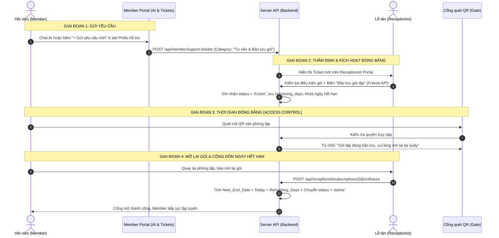

# ❄️ TÀI LIỆU NGHIỆP VỤ & THIẾT KẾ HỆ THỐNG: BẢO LƯU GÓI TẬP (MEMBERSHIP FREEZE)
> **Dự án:** Hệ thống Quản lý Trung tâm Thể thao (SmartGym OS / Sport Center - SWP391)  
> **Phạm vi tài liệu:** Đặc tả quy trình nghiệp vụ, ma trận phân quyền (RBAC), thiết kế kỹ thuật (Database & API) và kịch bản bảo vệ trước Hội đồng chấm thi FPT University.  
> **Đối tượng áp dụng:** Toàn bộ thành viên nhóm dự án (Frontend, Backend, Tester, BA/Product Owner).

---

## 📌 MỤC LỤC
1. [Tổng quan nghiệp vụ Bảo lưu (Membership Freeze)](#1-tổng-quan-nghiệp-vụ-bảo-lưu)
2. [Bảng Ma trận Phân quyền Trách nhiệm (RBAC Matrix)](#2-bảng-ma-trận-phân-quyền-trách-nhiệm-rbac)
3. [Quy trình vận hành chuẩn 4 giai đoạn (End-to-End Workflow)](#3-quy-trình-vận-hành-chuẩn-4-giai-đoạn)
4. [Chính sách & Ràng buộc bảo lưu (Business Rules & Constraints)](#4-chính-sách--ràng-buộc-bảo-lưu)
5. [Thiết kế Kỹ thuật & Mã nguồn (Database, Backend API & Frontend)](#5-thiết-kế-kỹ-thuật--mã-nguồn)
6. [Thuật toán & Công thức tính toán ngày hết hạn](#6-thuật-toán--công-thức-tính-toán-ngày-hết-hạn)
7. [Danh mục Test Cases & Edge Cases chuẩn SWP391](#7-danh-mục-test-cases--edge-cases-chuẩn-swp391)
8. [Kịch bản trả lời Hội đồng chấm thi (Q&A Defense Guide)](#8-kịch-bản-trả-lời-hội-đồng-chấm-thi)

---

## 1. TỔNG QUAN NGHIỆP VỤ BẢO LƯU

Trong thực tế vận hành tại các trung tâm thể thao cao cấp (như California Fitness, CityGym, Elite Fitness), **Bảo lưu thẻ tập (Membership Freeze / Suspension)** là nghiệp vụ bắt buộc nhằm:
- **Giữ chân khách hàng (Member Retention):** Khách hàng có việc bận đột xuất (công tác, thi cử, ốm đau, chấn thương) không bị mất tiền hay lãng phí ngày tập.
- **Minh bạch tài chính & dịch vụ:** Đóng băng gói tập đồng nghĩa với việc tạm khóa quyền ra vào cổng (Turnstile Gate) và khóa quyền đặt lịch lớp/PT, ngăn chặn gian lận "vừa xin bảo lưu vừa đi tập chui".

---

## 2. BẢNG MA TRẬN PHÂN QUYỀN TRÁCH NHIỆM (RBAC)

Để đảm bảo tính bảo mật và chống gian lận, việc bảo lưu **tuyệt đối không cho phép hội viên tự động bật/tắt tùy ý**, mà phải qua sự kiểm soát của nhân sự trung tâm:

| Vai trò (Role) | Trách nhiệm trong luồng Bảo lưu | Hành động trên Hệ thống |
| :--- | :--- | :--- |
| **Hội viên (Member)** | **Người gửi yêu cầu (Requester)** | Gửi yêu cầu qua **Tab Trợ lý AI** hoặc **Phiếu hỗ trợ (Support Tickets)** kèm lý do và khoảng thời gian mong muốn. Không có quyền tự ý sửa DB. |
| **Lễ tân (Receptionist)** | **Người tiếp nhận & Xử lý (Operator / Approver cấp 1)** | Tiếp nhận Ticket trên **Receptionist Portal**, kiểm tra điều kiện gói. Nếu hợp lệ (bảo lưu tiêu chuẩn 7 - 14 ngày), Lễ tân bấm duyệt kích hoạt bảo lưu. |
| **Quản lý (Manager)** | **Phê duyệt ngoại lệ (Approver cấp 2)** | Phê duyệt các ca bảo lưu dài hạn (**vài tháng**), bảo lưu do tai nạn có giấy xác nhận y tế, hoặc miễn giảm phí bảo lưu. |
| **Hệ thống (System Job)** | **Tự động mở khóa (Auto-Unfreeze)** | Chạy ngầm định kỳ: Khi đến hạn `FreezeUntil` mà khách chưa mở, hệ thống tự động đưa gói về `active` để tiếp tục tính ngày. |

---

## 3. QUY TRÌNH VẬN HÀNH CHUẨN 4 GIAI ĐOẠN



---

## 4. CHÍNH SÁCH & RÀNG BUỘC BẢO LƯU (BUSINESS RULES)

1. **Điều kiện bảo lưu:**
   - Chỉ áp dụng cho gói đang ở trạng thái hoạt động (`status = 'active'`).
   - Gói chưa hết hạn (`EndDate > DateTime.UtcNow`).
   - Thời gian bảo lưu tối thiểu: **7 ngày** (không cho bảo lưu 1 - 2 ngày lẻ tẻ để tránh quá tải vận hành).
2. **Quy định theo độ dài gói:**
   - **Gói 1 tháng (30 ngày):** Bảo lưu tối đa **14 ngày**. (Nếu khách muốn bảo lưu 2 - 3 tháng, trung tâm sẽ thu phí duy trì bảo lưu hoặc cần Quản lý duyệt).
   - **Gói 6 - 12 tháng:** Được bảo lưu tối đa **30 - 60 ngày** miễn phí.
3. **Số lần bảo lưu tối đa:** Tối đa **1 - 2 lần** trong suốt thời hạn hợp đồng.

---

## 5. THIẾT KẾ KỸ THUẬT & MÃ NGUỒN

### 5.1. Cơ sở dữ liệu (Database Schema)

Bổ sung các trường vào bảng gói hội viên (`Subscriptions` / `Member_Packages`):

```sql
ALTER TABLE Subscriptions 
ADD COLUMN Status VARCHAR(20) DEFAULT 'active', -- 'active' | 'frozen' | 'expired' | 'pending'
ADD COLUMN FrozenAt TIMESTAMP NULL,             -- Ngày bắt đầu đóng băng
ADD COLUMN FreezeUntil TIMESTAMP NULL,          -- Ngày dự kiến tự động kích hoạt lại
ADD COLUMN RemainingDaysAtFreeze INT DEFAULT 0, -- Số ngày dư của gói được bảo lưu
ADD COLUMN FreezeReason TEXT NULL;              -- Lý do xin bảo lưu
```

---

### 5.2. Backend Minimal API (C# .NET)

#### API 1: Kích hoạt Bảo lưu gói (Lễ tân thực hiện)
* **Route:** `POST /api/receptionist/subscriptions/{id}/freeze`
* **Quyền:** `Receptionist`, `Manager`, `Admin`

```csharp
app.MapPost("/api/receptionist/subscriptions/{id:guid}/freeze", async (
    Guid id, 
    FreezeSubscriptionDto dto, 
    AppDbContext db) =>
{
    var sub = await db.Subscriptions.FindAsync(id);
    if (sub == null) 
        return Results.NotFound(new { message = "Không tìm thấy thông tin gói tập." });

    if (sub.Status != "active") 
        return Results.BadRequest(new { message = "Chỉ có thể bảo lưu gói đang hoạt động." });

    var now = DateTime.UtcNow;
    if (sub.EndDate <= now) 
        return Results.BadRequest(new { message = "Gói tập đã hết hạn, không thể bảo lưu." });

    // 1. Tính toán chính xác số ngày còn lại của gói
    int remainingDays = (int)Math.Ceiling((sub.EndDate - now).TotalDays);

    // 2. Chuyển trạng thái sang FROZEN
    sub.Status = "frozen";
    sub.FrozenAt = now;
    sub.FreezeUntil = dto.FreezeUntilDate;
    sub.RemainingDaysAtFreeze = remainingDays;
    sub.FreezeReason = dto.Reason;

    await db.SaveChangesAsync();

    return Results.Ok(new { 
        success = true,
        message = $"Đã bảo lưu thành công {remainingDays} ngày tập cho hội viên.",
        status = sub.Status,
        freezeUntil = sub.FreezeUntil
    });
}).RequireAuthorization("ReceptionistOrManager");
```

#### API 2: Chặn cổng Check-in khi gói đang bị đóng băng
* **File liên quan:** Logic Check-in tại quầy hoặc máy quét QR cổng.

```csharp
if (subscription.Status == "frozen")
{
    return Results.BadRequest(new {
        success = false,
        code = "SUBSCRIPTION_FROZEN",
        message = "Gói tập của bạn đang ở trạng thái BẢO LƯU. Vui lòng liên hệ quầy Lễ tân để kích hoạt mở lại trước khi vào tập!"
    });
}
```

#### API 3: Mở lại gói tập (Unfreeze API)
* **Route:** `POST /api/receptionist/subscriptions/{id}/unfreeze`
* **Quyền:** `Receptionist`, `Manager`, `Admin`

```csharp
app.MapPost("/api/receptionist/subscriptions/{id:guid}/unfreeze", async (Guid id, AppDbContext db) =>
{
    var sub = await db.Subscriptions.FindAsync(id);
    if (sub == null || sub.Status != "frozen") 
        return Results.BadRequest(new { message = "Gói tập không ở trạng thái bảo lưu." });

    var now = DateTime.UtcNow;

    // TÍNH TOÁN NGÀY HẾT HẠN MỚI = HÔM NAY + SỐ NGÀY ĐÃ BẢO LƯU TRƯỚC ĐÓ
    sub.EndDate = now.AddDays(sub.RemainingDaysAtFreeze);
    sub.Status = "active";
    sub.FrozenAt = null;
    sub.FreezeUntil = null;
    sub.RemainingDaysAtFreeze = 0;

    await db.SaveChangesAsync();

    return Results.Ok(new {
        success = true,
        message = "Đã kích hoạt mở lại gói tập thành công!",
        newEndDate = sub.EndDate
    });
}).RequireAuthorization("ReceptionistOrManager");
```

---

### 5.3. Frontend UI Components

* **Bên Member Portal:**
  - [MemberSupport.tsx](file:///e:/SWP391_Projects_Sport_Center/Sport_Center/Frontend/src/pages/MemberPortal/views/MemberSupport.tsx): Điều phối 2 tab "Trợ lý AI 24/7" và "Phiếu hỗ trợ".
  - [SupportTickets.tsx](file:///e:/SWP391_Projects_Sport_Center/Sport_Center/Frontend/src/pages/MemberPortal/views/support/SupportTickets.tsx): Hội viên bấm "Gửi yêu cầu mới", chọn danh mục `📋 Tư vấn dịch vụ & Gia hạn gói tập` để xin bảo lưu.
* **Bên Receptionist Portal:**
  - [SupportTicketsPage.tsx](file:///e:/SWP391_Projects_Sport_Center/Sport_Center/Frontend/src/pages/ReceptionistPortal/views/SupportTicketsPage.tsx): Lễ tân tiếp nhận yêu cầu xin bảo lưu từ hội viên.
  - [DetailPage.tsx](file:///e:/SWP391_Projects_Sport_Center/Sport_Center/Frontend/src/pages/ReceptionistPortal/views/DetailPage.tsx): Quản lý chi tiết hội viên, hiển thị nút bấm `❄️ Bảo lưu gói tập` (khi status = active) và nút `▶️ Mở lại gói tập` (khi status = frozen).

---

## 6. THUẬT TOÁN & CÔNG THỨC TÍNH TOÁN NGÀY HẾT HẠN

$$Ngày\_Hết\_Hạn\_Mới = Ngày\_Mở\_Lại\_Thực\_Tế + Số\_Ngày\_Dư\_Lúc\_Bảo\_Lưu$$

### Ví dụ minh họa thực tế:
1. Ngày 01/10: Hội viên mua gói 1 tháng (30 ngày) ➔ Ngày hết hạn ban đầu là **31/10**.
2. Ngày 11/10: Hội viên đi tập được 10 ngày (còn dư **20 ngày**). Hội viên xin bảo lưu do đi công tác 2 tuần.
3. Lễ tân bấm duyệt bảo lưu ➔ Gói chuyển `status = 'frozen'`, lưu `RemainingDays = 20`.
4. Ngày 25/10: Hội viên về nước, đến phòng tập quét mã. Lễ tân bấm **Mở lại gói**:
   $$\text{EndDate Mới} = \text{25/10} + \text{20 ngày} = \text{14/11}$$
5. **Kết quả:** Hội viên được bảo lưu trọn vẹn 20 ngày còn lại mà không mất quyền lợi.

---

## 7. DANH MỤC TEST CASES & EDGE CASES CHUẨN SWP391

| Mã Case | Tên tình huống kiểm thử | Dữ liệu đầu vào | Kết quả mong đợi (Expected Result) |
| :---: | :--- | :--- | :--- |
| **TC-BL-01** | Hội viên gửi yêu cầu bảo lưu hợp lệ | Lý do công tác 2 tuần | Tạo Ticket thành công, Lễ tân nhận được thông báo. |
| **TC-BL-02** | Lễ tân duyệt bảo lưu gói đang hoạt động | Gói `active`, còn 15 ngày | `status` chuyển thành `frozen`, lưu `RemainingDays = 15`. |
| **TC-BL-03** | Khách quét mã vào cổng khi đang bảo lưu | Gói `status = 'frozen'` | Cổng từ chối, báo lỗi: *"Gói tập đang bảo lưu"*. |
| **TC-BL-04** | Khách đặt lịch học (Booking) khi đang bảo lưu | Gói `status = 'frozen'` | Chặn nút đặt lịch trên Member Portal. |
| **TC-BL-05** | Mở lại gói trước hạn bảo lưu | Lễ tân bấm Unfreeze ngày thứ 10 | Gói chuyển `active`, dời ngày hết hạn đúng công thức. |
| **TC-BL-06** | Bảo lưu cho gói đã hết hạn | Gói `status = 'expired'` | Chặn thao tác, báo lỗi: *"Gói đã hết hạn, không thể bảo lưu"*. |
| **TC-BL-07** | Hội viên cố tình gọi API Freeze trực tiếp | Token Member gọi API Lễ tân | Trả về mã lỗi `403 Forbidden` (Chặn theo RBAC). |

---

## 8. KỊCH BẢN TRẢ LỜI HỘI ĐỒNG CHẤM THI (Q&A DEFENSE GUIDE)

> **Hội đồng hỏi 1:** *"Tại sao hệ thống không để hội viên tự bấm nút Đóng băng trên app mà phải qua Lễ tân hoặc gửi Ticket?"*  
> **Trả lời:** "Dạ thưa thầy/cô, để tránh **lạm dụng chính sách (Abuse & Fraud)**. Nếu cho hội viên tự do đóng băng, họ có thể tập 2 ngày cuối tuần rồi bấm đóng băng 5 ngày trong tuần, gây thất thoát doanh thu của phòng tập. Quy trình chuẩn thực tế là Hội viên đề xuất qua Ticket/AI, Lễ tân thẩm định số lần bảo lưu và thời hạn hợp lệ mới kích hoạt."

> **Hội đồng hỏi 2:** *"Nếu hội viên bảo lưu xong rồi quên luôn 6 tháng sau mới quay lại thì hệ thống xử lý sao?"*  
> **Trả lời:** "Dạ, hệ thống có thiết kế trường `FreezeUntil` (Hạn bảo lưu tối đa, ví dụ tối đa 30 ngày cho gói ngắn hạn). Nếu quá hạn này mà hội viên không đến mở lại, hệ thống có Background Job tự động chuyển gói về `active` và tiếp tục đếm ngược ngày hết hạn để đảm bảo quyền lợi và doanh thu của trung tâm."

---
*Tài liệu này là căn cứ chính thức để toàn bộ team đối soát luồng công việc và đưa vào slide báo cáo đồ án SWP391.*
