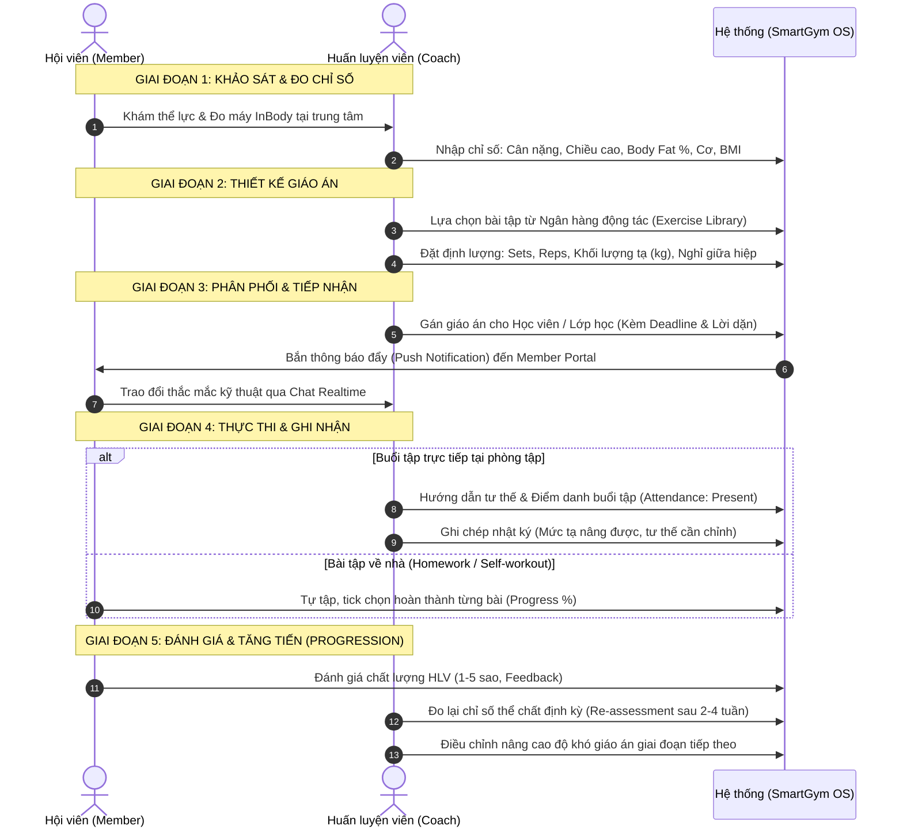

# 🏋️ TÀI LIỆU NGHIỆP VỤ & THIẾT KẾ HỆ THỐNG: QUẢN LÝ GIÁO ÁN TẬP LUYỆN (COACH & MEMBER)
> **Dự án:** Hệ thống Quản lý Trung tâm Thể thao (SmartGym OS / Sport Center)  
> **Phạm vi tài liệu:** Luồng tương tác giữa Huấn luyện viên (Coach) và Hội viên (Member) về Giáo án (Curriculum / Workout Plan), quy trình vận hành thực tế và **toàn bộ các trường hợp ngoại lệ (Edge Cases)** phát sinh trong thực tế.

---

## 📌 MỤC LỤC
1. [Tổng quan & Phân loại Giáo án trong Trung tâm Thể thao](#1-tổng-quan--phân-loại-giáo-án)
2. [Chu trình nghiệp vụ chuẩn 5 giai đoạn (End-to-End Lifecycle)](#2-chu-trình-nghiệp-vụ-chuẩn-5-giai-đoạn)
3. [Danh mục toàn bộ các trường hợp thực tế (Comprehensive Edge Cases)](#3-danh-mục-toàn-bộ-các-trường-hợp-thực-tế)
   - [Nhóm A: Tính trung thực & Sai lệch dữ liệu (Data Integrity & Fraud)](#nhóm-a-tính-trung-thực--sai-lệch-dữ-liệu)
   - [Nhóm B: Tuân thủ & Tiến độ thực thi (Compliance & Adherence)](#nhóm-b-tuân-thủ--tiến-độ-thực-thi)
   - [Nhóm C: Thể lực, Sức khỏe & Điều kiện tập luyện (Physical & Environment Mismatch)](#nhóm-c-thể-lực-sức-khỏe--điều-kiện-tập-luyện)
   - [Nhóm D: Các tình huống từ phía Huấn luyện viên (Coach-Side Scenarios)](#nhóm-d-các-tình-huống-từ-phía-huấn-luyện-viên)
   - [Nhóm E: Hợp đồng, Gói tập & Khiếu nại (Membership & Disputes)](#nhóm-e-hợp-đồng-gói-tập--khiếu-nại)
4. [Bảng Ma trận trạng thái & Cơ chế kỹ thuật (State Machine & System Rules)](#4-bảng-ma-trận-trạng-thái--cơ-chế-kỹ-thuật)
5. [Thiết kế Kỹ thuật & Ánh xạ vào Hệ thống (Database & Frontend)](#5-thiết-kế-kỹ-thuật--ánh-xạ-hệ-thống)
6. [Kịch bản trả lời Hội đồng Bảo vệ Đồ án (Q&A Defense Guide)](#6-kịch-bản-trả-lời-hội-đồng-bảo-vệ-đồ-án)
7. 📄 **[Tài liệu 8 Test Cases chuẩn môn SWP391 (SRS & Testing)](SWP391_Cac_Truong_Hop_Giao_An.md)**

---

## 1. TỔNG QUAN & PHÂN LOẠI GIÁO ÁN

Trong thực tế vận hành tại các trung tâm thể thao cao cấp (như California Fitness, Elite Fitness, FitX...), giáo án không chỉ đơn thuần là một danh sách các động tác mà là **công cụ cốt lõi đảm bảo mục tiêu sức khỏe của hội viên và tỷ lệ duy trì hợp đồng (Member Retention Rate)**.

Giáo án được chia thành hai mô hình rõ rệt:

| Tiêu chí | 1. Giáo án Lớp nhóm (Group Class / Group-X) | 2. Giáo án Cá nhân (Personal Trainer - PT 1-on-1) |
| :--- | :--- | :--- |
| **Đối tượng** | Áp dụng chung cho cả lớp (Yoga, Zumba, Boxing, Cardio...) | Cá nhân hóa cho 1 học viên cụ thể |
| **Mục tiêu** | Đốt calo, tạo không khí cộng đồng, duy trì phản xạ vận động | Đạt mục tiêu cá nhân: Giảm mỡ, tăng cơ, trị liệu thoát vị, siết cân... |
| **Cơ sở xây dựng** | Khung chuẩn của bộ môn theo từng buổi học | Dựa trên chỉ số thể lực (`InBody`) và tiền sử chấn thương |
| **Hình thức giao** | HLV chuẩn bị trước giờ dạy và trình chiếu/hướng dẫn trực tiếp | HLV giao trực tiếp qua app + bài tập tự luyện tại nhà (**Homework**) |

---

## 2. CHU TRÌNH NGHIỆP VỤ CHUẨN 5 GIAI ĐOẠN



---

## 3. DANH MỤC TOÀN BỘ CÁC TRƯỜNG HỢP THỰC TẾ

Dưới đây là tổng hợp đầy đủ **16 trường hợp và kịch bản ngoại lệ (Edge Cases)** phân theo 5 nhóm nghiệp vụ, đi kèm giải pháp hệ thống và hành động của huấn luyện viên:

```
+---------------------------------------------------------------------------------+
|                   CÁC NHÓM TRƯỜNG HỢP VỀ GIÁO ÁN (COACH - MEMBER)               |
+---------------------------------------------------------------------------------+
|  [Nhóm A] Tính trung thực & Dữ liệu     |  [Nhóm B] Tuân thủ & Tiến độ          |
|  - A1: Khai man chỉ số InBody           |  - B1: Bỏ bê hoàn toàn (Ghosting)     |
|  - A2: Tick hoàn thành thần tốc         |  - B2: Tập dở dang (Incomplete)       |
|  - A3: Nhập mức tạ phi thực tế          |  - B3: Quá hạn bài tập (Overdue)      |
|  - A4: Tập thật nhưng quên tick         |  - B4: Tập quá tải (Overtraining)     |
|  - A5: HLV nhập nhầm dữ liệu            |  - B5: Xin tạm hoãn tập (Pause)       |
+-----------------------------------------+---------------------------------------+
|  [Nhóm C] Thể lực & Điều kiện tập       |  [Nhóm D] Phía Huấn luyện viên        |
|  - C1: Bài tập quá nặng / quá nhẹ       |  - D1: HLV quên giao bài mới          |
|  - C2: Thiếu dụng cụ tập tại nhà        |  - D2: Đổi HLV giữa chừng (Handover)  |
|  - C3: Đau cơ cấp tính / Chấn thương    |  - D3: HLV chậm phản hồi Chat         |
|  - C4: Đổi mục tiêu luyện tập           +---------------------------------------+
+-----------------------------------------+  [Nhóm E] Hợp đồng & Khiếu nại        |
                                          |  - E1: Hết buổi PT khi giáo án dở dang|
                                          |  - E2: Khiếu nại tập không hiệu quả   |
                                          +---------------------------------------+
```

---

### NHÓM A: TÍNH TRUNG THỰC & SAI LỆCH DỮ LIỆU

#### Case A1: Member tự ý chỉnh sửa / khai man chỉ số InBody
* **Tình huống:** Member muốn đạt giải thưởng thử thách giảm cân (Fitness Challenge) hoặc tự ti nên tự sửa số cân nặng từ 75kg xuống 68kg.
* **Hậu quả:** Sai lệch cơ sở thiết kế giáo án, tính toán sai lượng calo thâm hụt, có nguy cơ ngất do kiệt sức.
* **Giải pháp Hệ thống:**
  * **RBAC nghiêm ngặt:** Khóa quyền sửa (Read-only) với Member trên các bản ghi InBody chính thức.
  * Chỉ tài khoản `Coach` hoặc `Receptionist` mới có quyền tạo bản ghi đo (`recorded_by`).
  * Nếu cho Member tự theo dõi ở nhà, tách riêng trường `is_official = false` và đánh nhãn *"Tự đo - Tham khảo"*.
* **Hành động của Coach:** Yêu cầu học viên lên đo trực tiếp trên máy InBody của trung tâm trước khi nâng giáo án.

#### Case A2: Member tick "Hoàn thành" thần tốc (Speed-Ticking / Gian lận)
* **Tình huống:** Giáo án gồm 6 bài tập nặng (khoảng 45 phút), nhưng Member mở app và bấm tick xong toàn bộ 6 bài chỉ trong 30 giây để đối phó.
* **Hậu quả:** Coach tưởng học viên đã hoàn thành và tăng độ khó ở buổi sau, gây nguy cơ chấn thương gãy form.
* **Giải pháp Hệ thống:**
  * Lưu timestamp `completed_at` cho từng bài tập.
  * Cơ chế phát hiện bất thường (**Anomaly Detection Rule**): Nếu khoảng thời gian hoàn thành giữa các bài tập `< 2 phút`, hệ thống tự động gắn cờ `Anomalous Completion` và gửi cảnh báo đến màn hình của Coach.
* **Hành động của Coach:** Ở buổi tập trực tiếp tiếp theo, Coach cho thực hiện lại chính bài tập đó để kiểm tra thể lực (**Physical Test**). Khi thấy học viên không đạt, Coach sẽ phân tích tâm lý và giải thích rằng tập luyện là vì sức khỏe bản thân.

#### Case A3: Member nhập mức tạ phi thực tế (Unrealistic Log)
* **Tình huống:** Nữ mới tập 1 tháng nhưng ghi log tự tập Deadlift 180kg x 10 reps (gõ nhầm số 18kg thành 180kg hoặc cố ý "sống ảo").
* **Giải pháp Hệ thống:**
  * Áp dụng **Data Validation Bounds**: Cảnh báo ngay trên giao diện nếu mức tạ vượt quá 2.5 lần trọng lượng cơ thể học viên: *"Mức tạ này có vẻ bất thường, bạn có chắc chắn là 180kg không?"*.
* **Hành động của Coach:** Nhắn tin hỏi thăm xác nhận học viên có gõ nhầm hay không để hiệu chỉnh dữ liệu nhật ký.

#### Case A4: Member có tập thật nhưng quên không tick trên App
* **Tình huống:** Học viên tập đầy đủ ở nhà theo giáo án nhưng do vội đi làm nên quên mở app tick, dẫn đến bài tập bị hệ thống đánh dấu là `Overdue` (Quá hạn).
* **Giải pháp Hệ thống:**
  * Cho phép học viên bấm **"Gửi yêu cầu xác nhận bù" (Request Retroactive Completion)** kèm ghi chú thời gian đã tập.
  * Coach nhận được thông báo duyệt: Nếu thấy học viên thường ngày chăm chỉ, Coach bấm *"Xác nhận đã tập"* để hệ thống khôi phục tiến độ 100%.
* **Hành động của Coach:** Duyệt bài và nhắc học viên lần sau nên tick ngay trong khi nghỉ giữa hiệp để app đếm thời gian chuẩn.

#### Case A5: Huấn luyện viên nhập nhầm dữ liệu / Gán nhầm giáo án
* **Tình huống:** HLV có 15 học viên, vô tình gán giáo án siết mỡ của vận động viên cho một học viên nữ mới sinh em bé.
* **Giải pháp Hệ thống:**
  * Cho phép Coach thực hiện chức năng **"Thu hồi giáo án" (Revoke Plan)** nếu học viên chưa bắt đầu tập.
  * Bổ sung màn hình xem trước (Preview) kèm thông tin thể trạng của học viên trước khi bấm nút `Xác nhận giao`.
* **Hành động của Coach:** Lập tức nhắn tin xin lỗi, thu hồi giáo án nhầm và giao lại đúng giáo án phù hợp.

---

### NHÓM B: TUÂN THỦ & TIẾN ĐỘ THỰC THI

#### Case B1: Member bỏ bê hoàn toàn (Ghosting / Churn Risk)
* **Tình huống:** HLV giao bài tập nhưng học viên không mở app suốt 7 ngày, gọi điện không bắt máy, quá hạn deadline 100%.
* **Hậu quả:** Đây là dấu hiệu số 1 của việc khách hàng chuẩn bị bỏ tập và không tái tục hợp đồng.
* **Giải pháp Hệ thống:**
  * Tự động chuyển trạng thái bài tập sang `Abandoned / Missed`.
  * Đánh cờ đỏ **`High Churn Risk` (Nguy cơ bỏ cuộc cao)** trên màn hình danh sách học viên của Coach.
  * Tự động gửi thông báo động viên sau 3 ngày và 5 ngày im lặng.
* **Hành động của Coach:** Không chỉ nhắn tin trên app mà cần gọi điện trực tiếp, tìm hiểu xem học viên có gặp trở ngại gì trong cuộc sống hay không và đề xuất hạ mục tiêu xuống mức tối thiểu (chỉ cần đến phòng tập 15 phút giãn cơ).

#### Case B2: Member tập dở dang (Incomplete Workout)
* **Tình huống:** Giáo án có 5 bài, học viên tập được 2 bài thì bị chuột rút hoặc bận việc đột xuất nên dừng lại (Tiến độ dừng ở 40%).
* **Giải pháp Hệ thống:**
  * Cho phép học viên chọn **"Tạm dừng & Lưu tiến độ"**.
  * Bổ sung trường ghi chú: *"Lý do chưa hoàn thành: Bận việc / Mệt"*.
  * Hệ thống ghi nhận tiến độ bán phần (Partial Progress) chứ không ép buộc 0% hay 100%.
* **Hành động của Coach:** Kiểm tra ghi chú lý do. Nếu do quá mệt, Coach sẽ giảm bớt 1-2 bài ở giáo án buổi tiếp theo.

#### Case B3: Member hoàn thành bài tập nhưng trễ hạn (Overdue Completion)
* **Tình huống:** Hạn nộp là Chủ nhật, nhưng đến tối Thứ 3 tuần sau học viên mới hoàn thành.
* **Giải pháp Hệ thống:**
  * Đánh dấu trạng thái là `Completed Late` (Hoàn thành trễ) kèm số ngày trễ.
  * Vẫn cộng điểm tích lũy hoặc duy trì chuỗi ngày tập luyện (Streak) để khuyến khích học viên không bỏ cuộc.
* **Hành động của Coach:** Động viên tinh thần *"Trễ còn hơn không"*, đồng thời dời lịch giao giáo án tuần mới sang Thứ 4 để học viên có thời gian hồi phục cơ.

#### Case B4: Member tập quá tải (Overtraining / Nghiện tập)
* **Tình huống:** Học viên nôn nóng giảm cân, tự ý tập thêm 2 lần giáo án trong ngày hoặc tập cả vào ngày HLV xếp lịch nghỉ (Rest Day).
* **Hậu quả:** Tiêu cơ vân, kiệt sức, suy giảm hệ miễn dịch hoặc chấn thương rách cơ.
* **Giải pháp Hệ thống:**
  * Cảnh báo trên app: *"Hôm nay là ngày nghỉ ngơi phục hồi (Rest Day). Cơ bắp cần thời gian tái tạo!"*.
* **Hành động của Coach:** Giải thích khoa học về sự phục hồi cơ bắp; nếu học viên quá thừa năng lượng, Coach hướng dẫn chuyển sang các bài hồi phục chủ động (Active Recovery) như đi bộ nhẹ hoặc ngâm bồn nước ấm.

#### Case B5: Member xin tạm hoãn tập do lý do bất khả kháng (Medical / Travel Pause)
* **Tình huống:** Học viên đi công tác nước ngoài 2 tuần hoặc bị sốt xuất huyết cần nghỉ ngơi hoàn toàn.
* **Giải pháp Hệ thống:**
  * Cung cấp nút **"Đóng băng giáo án" (Freeze / Pause Plan)**: Toàn bộ Deadline các bài tập được tự động lùi lại số ngày tương ứng với thời gian đóng băng.
* **Hành động của Coach:** Chuyển sang giáo án dinh dưỡng và vận động nhẹ nhàng (nếu đi công tác) hoặc dặn dò nghỉ ngơi tuyệt đối (nếu bị ốm).

---

### NHÓM C: THỂ LỰC, SỨC KHỎE & ĐIỀU KIỆN TẬP LUYỆN

#### Case C1: Giáo án không tương thích độ khó (Quá nặng hoặc quá nhẹ)
* **Tình huống:** Bài tập tạ 40kg nhưng học viên nâng bị đau lưng dưới (quá nặng), hoặc bài Plank 30 giây học viên thấy quá nhẹ nhàng.
* **Giải pháp Hệ thống:**
  * Sau mỗi bài tập, app có pop-up hỏi nhanh 1 chạm: **"Bạn thấy bài này thế nào?"** (3 lựa chọn: Quá dễ - Vừa sức - Quá nặng).
  * Dữ liệu này được tổng hợp và hiển thị cho Coach xem.
* **Hành động của Coach:** Vào màn hình chỉnh sửa giáo án, điều chỉnh mức tạ / số lần lặp ngay lập tức cho các buổi tiếp theo.

#### Case C2: Thiếu dụng cụ tập luyện tại nhà (Missing Equipment)
* **Tình huống:** Giáo án yêu cầu dùng tạ đơn (Dumbbell) nhưng học viên đang đi du lịch ở khách sạn không có phòng gym.
* **Giải pháp Hệ thống:**
  * Tính năng **"Bài tập thay thế" (Alternative Exercise)**: Cho phép học viên bấm vào bài tập và chọn biến thể Bodyweight (dùng trọng lượng cơ thể) mà không cần tạ.
* **Hành động của Coach:** Cài đặt sẵn các bài tập thay thế tương đương nhóm cơ trong thư viện bài tập.

#### Case C3: Học viên bị chấn thương / đau cơ cấp tính trong khi tập
* **Tình huống:** Học viên đang tập bài Deadlift thì nghe tiếng khục ở thắt lưng và đau nhói.
* **Giải pháp Hệ thống:**
  * Có nút khẩn cấp **"Báo cáo chấn thương / Dừng tập"**: Lập tức hủy buổi tập hiện tại và gửi thông báo khẩn đến Coach.
* **Hành động của Coach:** Nhắn tin/gọi điện hướng dẫn sơ cứu R.I.C.E (Nghỉ ngơi, chườm đá, băng ép, kê cao), khuyên đi khám bác sĩ và đóng băng toàn bộ các bài tập liên quan đến vùng lưng.

#### Case C4: Học viên thay đổi mục tiêu giữa chừng
* **Tình huống:** Ban đầu học viên đăng ký gói giảm mỡ, nhưng sau 1 tháng muốn chuyển sang tập tăng cơ vòng 3 và tăng sức bền chạy Marathon.
* **Giải pháp Hệ thống:**
  * Cập nhật mục tiêu trên [CoachMemberProfile.tsx](file:///e:/SWP391_Projects_Sport_Center/Sport_Center/Frontend/src/pages/CoachPortal/views/CoachMemberProfile.tsx).
  * Lưu trữ phiên bản giáo án cũ (Version 1 - Fat Loss) và kích hoạt giáo án mới (Version 2 - Hypertrophy).
* **Hành động của Coach:** Xây dựng lại Macro dinh dưỡng và cấu trúc lại phân chia lịch tập (Split Workout Routine).

---

### NHÓM D: CÁC TÌNH HUỐNG TỪ PHÍA HUẤN LUYỆN VIÊN

#### Case D1: Huấn luyện viên quên giao giáo án mới
* **Tình huống:** Học viên hoàn thành giáo án tuần cũ, đầu tuần mới mở app ra thì trống trơn không có bài tập nào.
* **Giải pháp Hệ thống:**
  * **Hệ thống nhắc việc tự động cho HLV (Coach Reminder):** Vào chiều Chủ nhật, hệ thống quét danh sách học viên; nếu học viên nào chưa có giáo án cho tuần tới, hệ thống gửi thông báo nhắc HLV: *"Bạn có 3 học viên chưa được lên giáo án cho tuần tới!"*.
* **Hành động của Coach:** Dùng tính năng sao chép giáo án mẫu (Duplicate Template) để giao bài nhanh trong vòng 2 phút.

#### Case D2: Thay đổi Huấn luyện viên giữa chừng (Coach Handover)
* **Tình huống:** HLV cũ nghỉ việc hoặc học viên yêu cầu đổi HLV khác.
* **Giải pháp Hệ thống:**
  * Tính năng **Chuyển giao hồ sơ (Handover Dossier)**: HLV mới nhận được toàn bộ lịch sử điểm danh, các giáo án cũ, các ghi chú thói quen và biểu đồ InBody của học viên mà không cần hỏi lại từ đầu.
* **Hành động của Coach:** HLV mới đọc lại lịch sử ghi chú để hiểu rõ các vấn đề chấn thương trước đây của học viên trước khi lên giáo án mới.

#### Case D3: Huấn luyện viên chậm phản hồi thắc mắc kỹ thuật
* **Tình huống:** Học viên nhắn tin hỏi tư thế qua mục Chat nhưng 24 giờ sau HLV vẫn chưa trả lời.
* **Giải pháp Hệ thống:**
  * Đánh dấu tin nhắn `Chưa trả lời > 12h` bằng chấm đỏ ưu tiên trên Coach Portal.
  * Tích hợp trợ lý ảo AI (nếu có module AI) gợi ý câu trả lời tạm thời cho các câu hỏi kỹ thuật phổ biến.
* **Hành động của Coach:** Đặt khung giờ cố định trong ngày (ví dụ 11h30 - 12h00 và 17h00 - 17h30) để trả lời toàn bộ thắc mắc của học viên.

---

### NHÓM E: HỢP ĐỒNG, GÓI TẬP & KHIẾU NẠI

#### Case E1: Hết buổi PT hoặc hết hạn thẻ trong khi giáo án dở dang
* **Tình huống:** Học viên mua gói 12 buổi PT, đã tập hết buổi thứ 12 nhưng giáo án tập về nhà vẫn còn 2 tuần.
* **Giải pháp Hệ thống:**
  * Hệ thống hiển thị cảnh báo: *"Gói tập của bạn đã hoàn thành. Hãy gia hạn để tiếp tục nhận sự hướng dẫn từ HLV!"*.
  * Cho phép học viên tiếp tục xem các giáo án đã hoàn thành trong quá khứ dưới dạng Read-only (Lịch sử tập).
* **Hành động của Coach:** Buổi tập số 11 hoặc 12, Coach tổng kết tiến độ và tư vấn học viên tái ký hợp đồng mới.

#### Case E2: Khiếu nại tập đúng giáo án nhưng không đạt kết quả
* **Tình huống:** Học viên làm đầy đủ 100% giáo án trong 1 tháng nhưng cân nặng không giảm, học viên nổi nóng và đòi hoàn tiền.
* **Giải pháp Hệ thống:**
  * Hệ thống xuất báo cáo tổng hợp: Lịch sử điểm danh + Tỷ lệ hoàn thành giáo án + Nhật ký dinh dưỡng (`Diet_Plans`).
* **Hành động của Coach & Quản lý:** Dựa trên số liệu khoa học để đối thoại: 80% kết quả giảm cân đến từ ăn uống; nếu giáo án tập đạt 100% nhưng học viên nạp thừa calo (được ghi nhận trong diet logs), HLV sẽ giúp học viên siết lại chế độ ăn uống thay vì tranh cãi cảm tính.

---

## 4. BẢNG MA TRẬN TRẠNG THÁI & CƠ CHẾ KỸ THUẬT

```
+---------------------------------------------------------------------------------------------------------+
|                                    MA TRẬN CHUYỂN ĐỔI TRẠNG THÁI BÀI TẬP                                |
+------------------+-----------------------+---------------------+-------------------+--------------------+
| Trạng thái gốc   | Sự kiện kích hoạt     | Điều kiện kiểm tra  | Trạng thái đích   | Hành động hệ thống |
+------------------+-----------------------+---------------------+-------------------+--------------------+
| [None]           | HLV bấm Giao bài      | Due Date hợp lệ     | ASSIGNED          | Bắn Push Noti      |
| ASSIGNED         | Member mở xem & tick  | progress_pct > 0    | IN_PROGRESS       | Cập nhật % thanh đo|
| IN_PROGRESS      | Member tick 100% bài  | now() <= Due Date   | COMPLETED         | Tăng chuỗi Streak  |
| IN_PROGRESS      | Member tick 100% bài  | now() > Due Date    | COMPLETED_LATE    | Ghi nhận trễ hạn   |
| ASSIGNED / IN_PRG| Hết ngày Due Date     | progress_pct < 100  | OVERDUE           | Đánh cờ đỏ cảnh báo|
| OVERDUE          | Quá 7 ngày không tập  | Không có tương tác  | ABANDONED / MISSED| Đưa vào Churn Risk |
| BẤT KỲ           | Member xin bảo lưu    | HLV bấm Duyệt hoãn  | FROZEN / PAUSED   | Lùi hạn chót       |
+------------------+-----------------------+---------------------+-------------------+--------------------+
```

---

## 5. THIẾT KẾ KỸ THUẬT & ÁNH XẠ HỆ THỐNG

### Sơ đồ quan hệ thực thể (ERD Snippet cho phần Giáo án & Đánh giá)

```
+------------------+         +---------------------+         +----------------------+
|      Users       | 1     * |    Workout_Plans    | 1     * |   Workout_Exercises  |
|------------------|<------->|---------------------|<------->|----------------------|
| id (PK)          |         | id (PK)             |         | id (PK)              |
| full_name        |         | user_id (FK -> User)|         | plan_id (FK -> Plan) |
| role_id          |         | coach_id (FK->Coach)|         | exercise_name        |
+------------------+         | plan_name           |         | sets, reps, weight   |
         ^                   | status (Overdue...) |         | rest_seconds         |
         | 1                 | due_date            |         | is_completed (bool)  |
         |                   | progress_pct        |         | completed_at (time)  |
         | *                 | is_flagged_anomaly  |         | note                 |
+------------------+         +---------------------+         +----------------------+
|   Body_Metrics   |
|------------------|
| id (PK)          |
| user_id (FK)     |
| weight, height   |
| body_fat, bmi    |
| is_official(bool)| ---> true: Máy đo trung tâm; false: Member tự cân ở nhà
| recorded_by (FK) | ---> Lưu ID người đo (Coach/Lễ tân) để kiểm toán
| recorded_at      |
+------------------+
```

### Ánh xạ màn hình Frontend trong Source Code hiện tại:

1. **Phía Huấn luyện viên (Coach Portal):**
   * [CoachCurriculum.tsx](file:///e:/SWP391_Projects_Sport_Center/Sport_Center/Frontend/src/pages/CoachPortal/views/CoachCurriculum.tsx): Quản lý kho giáo án mẫu, thêm mới, sửa bài tập.
   * [CurriculumAssignModal.tsx](file:///e:/SWP391_Projects_Sport_Center/Sport_Center/Frontend/src/pages/CoachPortal/views/curriculum/CurriculumAssignModal.tsx): Giao giáo án cho Lớp học hoặc cá nhân Member kèm ngày hết hạn.
   * [CoachMemberProfile.tsx](file:///e:/SWP391_Projects_Sport_Center/Sport_Center/Frontend/src/pages/CoachPortal/views/CoachMemberProfile.tsx): Theo dõi chỉ số InBody (`Body_Metrics`) và các giáo án đã giao cho học viên.
   * [CoachChat.tsx](file:///e:/SWP391_Projects_Sport_Center/Sport_Center/Frontend/src/pages/CoachPortal/views/CoachChat.tsx): Trao đổi, giải đáp kỹ thuật và động viên học viên.

2. **Phía Hội viên (Member Portal):**
   * [MemberWorkouts.tsx](file:///e:/SWP391_Projects_Sport_Center/Sport_Center/Frontend/src/pages/MemberPortal/views/MemberWorkouts.tsx): Xem bài tập được giao, tick hoàn thành từng bài, cập nhật tiến độ thanh `% Progress`, xem ghi chú của HLV.
   * [HomeworkDetailModal.tsx](file:///e:/SWP391_Projects_Sport_Center/Sport_Center/Frontend/src/pages/MemberPortal/views/workouts/HomeworkDetailModal.tsx): Xem chi tiết số set, số rep và hướng dẫn thực hiện từng bài.
   * [MemberProfileModern.tsx](file:///e:/SWP391_Projects_Sport_Center/Sport_Center/Frontend/src/pages/MemberPortal/views/MemberProfileModern.tsx): Theo dõi biểu đồ cân nặng, BMI và lịch sử thể trạng.

---

## 6. KỊCH BẢN TRẢ LỜI HỘI ĐỒNG BẢO VỆ ĐỒ ÁN (Q&A DEFENSE GUIDE)

### Câu hỏi 1: *"Giáo án này ai là người tạo? Member có tự tạo được không?"*
* **Trả lời chuẩn:**
  > *"Thưa thầy/cô, trong mô hình trung tâm thể thao chuyên nghiệp, giáo án là sản phẩm chuyên môn do **Huấn luyện viên (Coach)** xây dựng để đảm bảo tính an toàn y học và hiệu quả tập luyện. Member không tự tạo giáo án chuyên môn mà chỉ tiếp nhận giáo án được HLV thiết kế riêng theo thể trạng (InBody) của mình hoặc theo lớp học mà mình đăng ký."*

---

### Câu hỏi 2: *"Nếu Member tự bấm hoàn thành ở nhà mà không tập thật thì hệ thống xử lý thế nào?"*
* **Trả lời chuẩn:**
  > *"Thưa thầy/cô, việc tự tập ở nhà dựa trên cam kết tự giác của học viên. Tuy nhiên, hệ thống giải quyết vấn đề này qua 2 lớp bảo vệ:*
  > 1. *Về kỹ thuật: Hệ thống lưu Audit Log (`completed_at`) để phát hiện hành vi bất thường như tick hoàn thành 6 bài tập nặng trong vòng dưới 1 phút.*
  > 2. *Về nghiệp vụ: Các bài tập về nhà luôn bổ trợ cho các buổi tập trực tiếp (1-1 PT Session). Trong buổi tập trực tiếp, HLV luôn có bước kiểm tra thể lực thực tế (Physical Test). Nếu học viên khai khống ở nhà, họ sẽ không thể vượt qua bài kiểm tra thể lực trực tiếp với HLV."*

---

### Câu hỏi 3: *"Nếu Member bỏ tập, không làm giáo án thì hệ thống có biết không?"*
* **Trả lời chuẩn:**
  > *"Dạ có. Hệ thống quản lý giáo án theo vòng đời trạng thái (`Assigned` -> `In Progress` -> `Overdue` -> `Missed`). Khi quá hạn nộp, hệ thống sẽ:*
  > 1. *Tự động gửi thông báo đẩy nhắc nhở hội viên.*
  > 2. *Đánh dấu cờ đỏ cảnh báo trên màn hình của HLV phụ trách với tỷ lệ hoàn thành thấp.*
  > 3. *HLV sẽ lập tức nhận biết học viên có nguy cơ bỏ cuộc (Churn Risk) để nhắn tin hỏi thăm và điều chỉnh lại độ khó hoặc dời hạn nộp giáo án, giúp trung tâm tối ưu hóa tỷ lệ giữ chân khách hàng."*

---

### Câu hỏi 4: *"Dữ liệu InBody nếu để Member tự nhập thì có bị sai lệch không?"*
* **Trả lời chuẩn:**
  > *"Dạ thưa thầy/cô, hệ thống áp dụng cơ chế phân quyền RBAC nghiêm ngặt: Chỉ số InBody chính thức (dùng làm cơ sở cam kết hợp đồng) **chỉ có Coach hoặc Lễ tân** được phép nhập từ phiếu in máy đo chuyên dụng tại trung tâm (lưu kèm trường `recorded_by`). Nếu mở rộng cho Member tự nhập cân nặng tại nhà thì hệ thống phân loại thành dữ liệu tham khảo (`Self-reported`) và tách biệt hoàn toàn với dữ liệu chính thức."*
