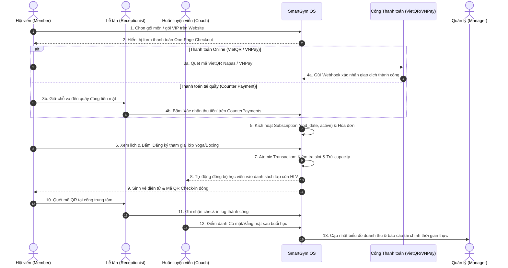
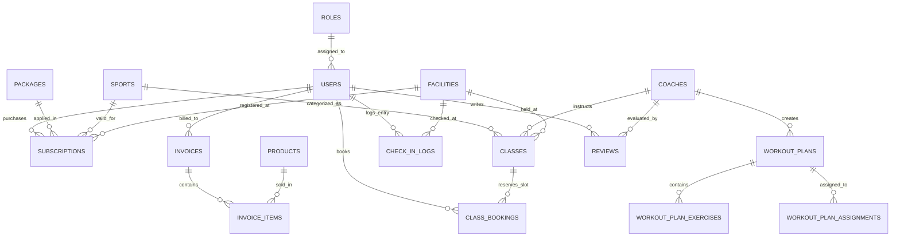
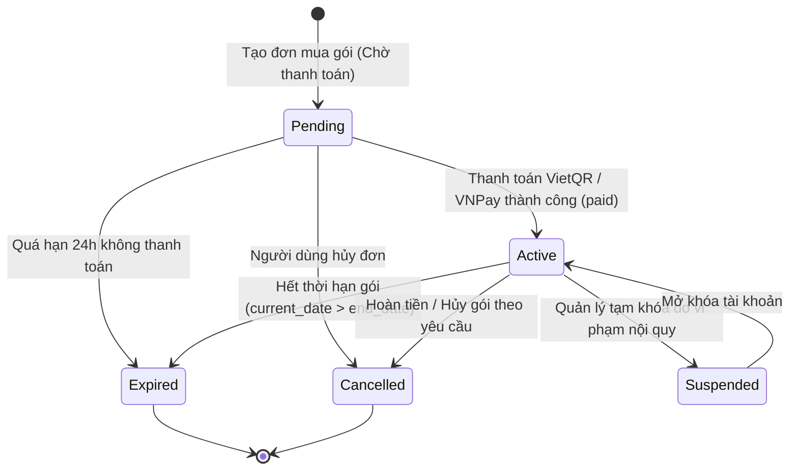
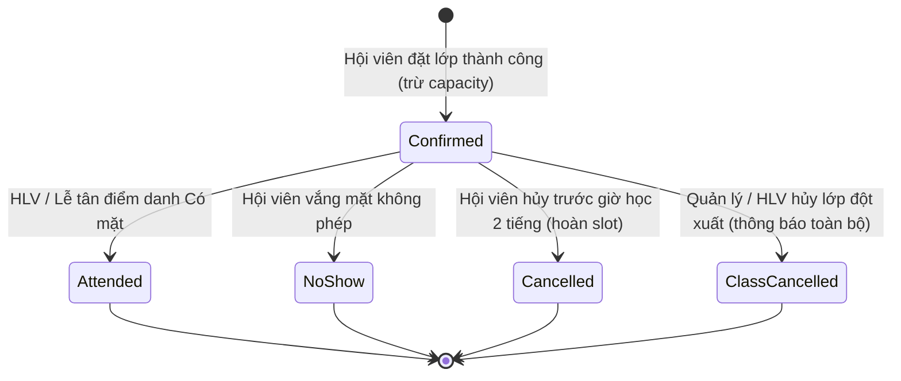
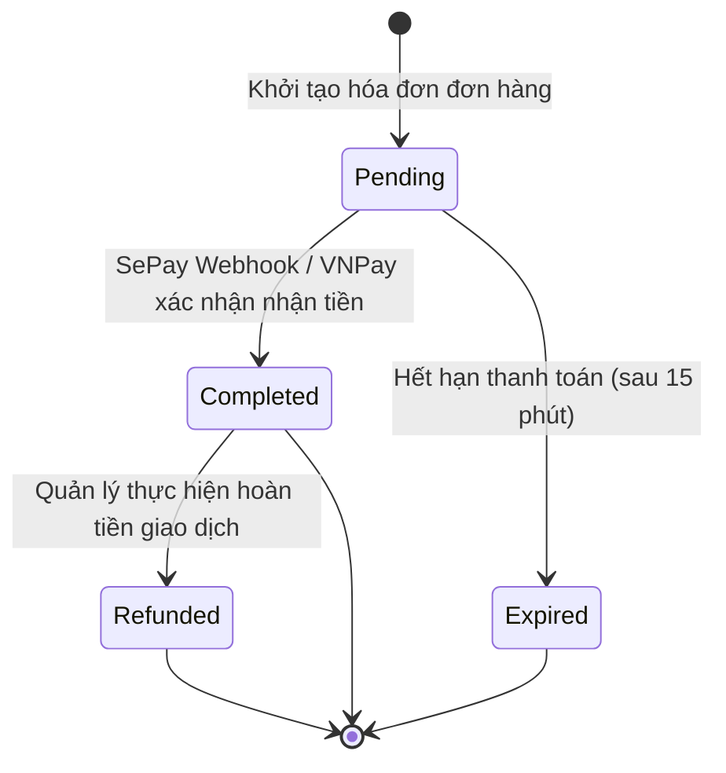

# SOFTWARE REQUIREMENTS SPECIFICATION (SRS)
## DỰ ÁN: SPORT CENTER MANAGEMENT SYSTEM (SMARTGYM OS)
> **Mã biểu mẫu tham chiếu:** `Template2_SRD Document` — FPT University SWP391  
> **Học phần:** SWP391 - Software Development Project  
> **Nhóm thực hiện:** Nhóm SWP391 - Sport Center  
> **Thành viên:** Phạm Đức Thanh Phương, Bùi Nam Thuận, Lê Hoàng Long, Hồ Xuân Anh Nam  
> **Ngày lập:** 31/10/2026 | **Phiên bản:** 2.5 (Hoàn thiện theo đúng chuẩn Template 2)

---

## 📝 RECORD OF CHANGES (LỊCH SỬ THAY ĐỔI TÀI LIỆU)

| Date | A\*, M, D | In charge | Change Description |
| :---: | :---: | :--- | :--- |
| **10/Sep/2026** | **A** | **PhuongPDT** | Khởi tạo tài liệu SRS theo Template 2; hoàn thiện Phần I.1 (Introduction, Scope, Context Diagram). |
| **18/Sep/2026** | **A** | **LongLH** | Bổ sung khảo sát Existing Systems (GymMaster, Mindbody) và vẽ sơ đồ Swimlane luồng đặt lớp & điểm danh (I.3). |
| **28/Sep/2026** | **A** | **NamHXA** | Thiết kế sơ đồ Screen Flow tổng thể (I.4.a), bảng Screen Details (I.4.b) và Ma trận Phân quyền User Authorization (I.4.c). |
| **08/Oct/2026** | **M** | **ThuanBN** | Cập nhật luồng thanh toán VNPay Sandbox, hóa đơn điện tử và cơ chế nạp tiền ví (Flow 3). |
| **18/Oct/2026** | **A** | **PhuongPDT** | Thêm đặc tả Flow 5: Tích hợp Google Gemini 1.5 Flash gợi ý giáo án tập luyện thông minh cho Huấn luyện viên. |
| **25/Oct/2026** | **M** | **ThuanBN** | Tích hợp cổng thanh toán SePay Webhook và VietQR Napas 247 auto-checkout vào quy trình thanh toán. |
| **31/Oct/2026** | **M** | **NamHXA, LongLH** | Bổ sung hoàn chỉnh ERD (I.5), State Transition Diagrams (I.6), Functional Requirements chi tiết (II) và Database Table Details (III) theo Template 2. |

*\*Ghi chú: **A** - Added (Thêm mới), **M** - Modified (Chỉnh sửa), **D** - Deleted (Loại bỏ).*

---

## 📑 TABLE OF CONTENTS (MỤC LỤC)

* [I. Overview](#i-overview)
  * [1. Introduction](#1-introduction)
    * [1.1. High-Level Product Overview](#11-high-level-product-overview)
    * [1.2. Product Context Diagram](#12-product-context-diagram)
  * [2. Existing Systems](#2-existing-systems)
    * [2.1. System 1: GymMaster Vietnam](#21-system-1-gymmaster-vietnam)
    * [2.2. System 2: Mindbody Online (Global)](#22-system-2-mindbody-online-global)
  * [3. Business Process](#3-business-process)
    * [3.1. Business Process Swimlane Diagram](#31-business-process-swimlane-diagram)
    * [3.2. Process Step Descriptions](#32-process-step-descriptions)
  * [4. System Functions](#4-system-functions)
    * [4.1. Screen Flow Diagram](#41-screen-flow-diagram)
    * [4.2. Screen Details Table](#42-screen-details-table)
    * [4.3. User Authorization Matrix](#43-user-authorization-matrix)
  * [5. Entity Relationship Diagram (ERD Conceptual)](#5-entity-relationship-diagram-erd-conceptual)
  * [6. State Transition Diagrams](#6-state-transition-diagrams)
* [II. Functional Requirements (Chi tiết Chức năng)](#ii-functional-requirements-chi-tiết-chức-năng)
  * [1. Feature 1: Quản lý Gói tập & Mua gói (Package & Subscription)](#1-feature-1-quản-lý-gói-tập--mua-gói-package--subscription)
  * [2. Feature 2: Quản lý Lớp học nhóm & Đặt chỗ Atomic (Class & Booking)](#2-feature-2-quản-lý-lớp-học-nhóm--đặt-chỗ-atomic-class--booking)
  * [3. Feature 3: Thanh toán VietQR SePay & VNPay Sandbox](#3-feature-3-thanh-toán-vietqr-sepay--vnpay-sandbox)
  * [4. Feature 4: Quản lý Ca dạy & Trợ lý Huấn luyện viên AI Copilot](#4-feature-4-quản-lý-ca-dạy--trợ-lý-huấn-luyện-viên-ai-copilot)
  * [5. Feature 5: Điểm danh Thẻ QR & Vận hành Quầy Lễ tân (Receptionist Operations)](#5-feature-5-điểm-danh-thẻ-qr--vận-hành-quầy-lễ-tân-receptionist-operations)
* [III. Database Design (Thiết kế Cơ sở Dữ liệu)](#iii-database-design-thiết-kế-cơ-sở-dữ-liệu)
  * [1. Database Schema & Table Descriptions](#1-database-schema--table-descriptions)
  * [2. Table Details (Đặc tả chi tiết từng cột trong bảng)](#2-table-details-đặc-tả-chi-tiết-từng-cột-trong-bảng)

---

## I. OVERVIEW

### 1. Introduction

#### 1.1. High-Level Product Overview
* **Tên sản phẩm:** Hệ thống Quản trị Trung tâm Thể thao Đa bộ môn (**SmartGym OS** / Sport Center).
* **Môi trường hoạt động (Environment):** 
  - Nền tảng Web Application đa thiết bị (Desktop, Laptop, Tablet, Mobile) hỗ trợ đầy đủ các trình duyệt hiện đại (Chrome, Edge, Safari, Firefox).
  - Backend triển khai trên .NET 10 (C#) Minimal API theo kiến trúc Clean Architecture; Cơ sở dữ liệu quan hệ PostgreSQL lưu trữ trên nền tảng điện toán đám mây Supabase.
  - Frontend xây dựng bằng React 19, TypeScript và Tailwind CSS 4 tối ưu hiệu năng render.
* **Đối tượng người dùng (Users):**
  1. **Guest (Khách vãng lai):** Xem danh mục bộ môn, bảng giá gói tập, lịch học mẫu và đăng ký tài khoản.
  2. **Member (Hội viên):** Mua gói tập, đăng ký lớp học nhóm, đặt slot PT 1-1, thanh toán VietQR/VNPay, theo dõi lịch sử điểm danh và nhận giáo án tập luyện.
  3. **Coach (Huấn luyện viên):** Quản lý ca dạy, điểm danh học viên, tạo slot PT, đổi ca/báo vắng và sử dụng trợ lý AI Gemini sinh giáo án.
  4. **Receptionist (Nhân viên Lễ tân):** Tiếp đón khách, quét mã QR thẻ hội viên check-in ra vào cổng, bán gói tập tại quầy (Counter Sales) và quản lý lịch hẹn tư vấn PT.
  5. **Center Manager (Quản lý Trung tâm / Admin):** Cấu hình danh mục bộ môn, quản trị phòng tập & cơ sở vật chất, quản lý nhân sự, theo dõi doanh thu và duyệt bảng lương.
* **Ràng buộc và Phụ thuộc (Constraints & Dependencies):**
  - Kết nối Internet liên tục để đồng bộ trạng thái thanh toán và điểm danh thời gian thực.
  - Phụ thuộc vào các cổng dịch vụ bên thứ ba: Cổng thanh toán **VNPay Sandbox**, Webhook **SePay (Sacombank / MB Bank)**, API tạo ảnh mã chuẩn **VietQR Napas 247**, Cloud lưu trữ media **Cloudinary CDN**, và dịch vụ trí tuệ nhân tạo **Google Gemini 1.5 Flash**.

#### 1.2. Product Context Diagram (Sơ đồ Ngữ cảnh Hệ thống)

```mermaid
flowchart TD
    subgraph External_Users [Người dùng tương tác]
        MEMBER[Hội viên / Thành viên<br>Member]
        COACH[Huấn luyện viên<br>Coach]
        RECEPT[Nhân viên Lễ tân<br>Receptionist]
        MANAGER[Quản lý Trung tâm<br>Center Manager]
        GUEST[Khách vãng lai<br>Guest]
    end

    subgraph Core_System [HỆ THỐNG SMARTGYM OS]
        SYSTEM((SmartGym OS<br>Sport Center System))
    end

    subgraph External_Services [Hệ thống & Dịch vụ Bên ngoài]
        VNPAY[Cổng Thanh toán VNPay]
        SEPAY[SePay Webhook & VietQR]
        GEMINI[Google Gemini 1.5 Flash AI]
        CLOUDINARY[Cloudinary Media CDN]
    end

    GUEST -->|Xem bộ môn, Đăng ký tài khoản| SYSTEM
    MEMBER -->|Mua gói, Đặt lớp, Quét QR Check-in, Chat| SYSTEM
    COACH -->|Điểm danh, Mở slot PT, Duyệt bài tập AI| SYSTEM
    RECEPT -->|Quét QR ra vào cổng, Thu tiền tại quầy, Đặt lịch PT| SYSTEM
    MANAGER -->|Quản lý bộ môn, phòng tập, nhân sự, bảng lương| SYSTEM

    SYSTEM -->|Chuyển hướng thanh toán, Nhận IPN xác nhận| VNPAY
    SYSTEM -->|Sinh mã VietQR Napas, Lắng nghe Webhook biến động số dư| SEPAY
    SYSTEM -->|Gửi tiêu chí thể lực, Nhận giáo án JSON cấu trúc| GEMINI
    SYSTEM -->|Tải lên ảnh chi nhánh, phòng tập, chứng chỉ HLV| CLOUDINARY
```



---

### 2. Existing Systems (Nghiên cứu các Hệ thống Hiện có)

#### 2.1. System 1: GymMaster Vietnam
* **Mô tả ngắn gọn:** Phần mềm quản lý phòng gym, yoga, fitness nội địa phổ biến tại Việt Nam ([gymmaster.vn](https://gymmaster.vn)).
* **Tác nhân chính:** Chủ phòng gym, Lễ tân, Hội viên.
* **Tính năng tiêu biểu:** Quản lý hội viên, kiểm soát cổng bằng vân tay/thẻ từ, bán gói tập, in hóa đơn nhiệt tại quầy.
* **Ưu điểm:** Tích hợp phần cứng kiểm soát ra vào tốt, phù hợp thị trường Việt Nam.
* **Nhược điểm:** Giao diện desktop kiểu cũ (WinForms), thiếu tính năng đặt lớp học nhóm linh hoạt trên web, không có AI cá nhân hóa bài tập, quy trình chuyển ca dạy của huấn luyện viên còn thủ công.
* **Điểm học hỏi & cải tiến của SmartGym OS:** Web-based hiện đại 100%, hỗ trợ check-in mã QR động trên smartphone không cần mang thẻ nhựa, bổ sung tính năng tự động hóa thanh toán VietQR Napas và trợ lý HLV AI.

#### 2.2. System 2: Mindbody Online (Global)
* **Mô tả ngắn gọn:** Nền tảng đám mây quản lý trung tâm thể hình, yoga và spa hàng đầu thế giới ([mindbodyonline.com](https://www.mindbodyonline.com)).
* **Tác nhân chính:** Business Owner, Instructor, Client, Front-desk Staff.
* **Tính năng tiêu biểu:** Đặt lịch trực tuyến, quản lý lịch trình giảng dạy đa môn, thanh toán thẻ tín dụng quốc tế (Stripe).
* **Ưu điểm:** Giao diện tối ưu trải nghiệm người dùng rất tốt, phân hệ đặt chỗ thông minh, biểu đồ báo cáo tài chính trực quan.
* **Nhược điểm:** Chi phí vận hành rất cao, không hỗ trợ các phương thức thanh toán đặc thù tại Việt Nam (VietQR, VNPay, chuyển khoản ngân hàng nội địa), không hỗ trợ quản lý gói môn độc lập kết hợp hội viên VIP.
* **Điểm học hỏi & cải tiến của SmartGym OS:** Học hỏi cơ chế đặt lịch và phân quyền RBAC đa cổng; tối ưu hóa chi phí với mô hình Clean Architecture .NET 10 + Supabase, bản địa hóa phương thức thanh toán tự động qua SePay VietQR và VNPay.

---

### 3. Business Process (Quy trình Nghiệp vụ Cốt lõi)

#### 3.1. Business Process Swimlane Diagram (Sơ đồ Phân làn Nghiệp vụ)



#### 3.2. Process Step Descriptions (Bảng Mô tả Từng bước Quy trình)

| # | Process Step (Bước thực hiện) | Tác nhân chính | Mô tả chi tiết nghiệp vụ | Hệ thống & Bảng CSDL tác động |
| :-: | :--- | :--- | :--- | :--- |
| **1** | **Chọn gói & Khởi tạo đơn** | Member | Hội viên lựa chọn gói môn (Bơi, Yoga, Gym...) hoặc gói nâng cấp VIP/Plus theo chu kỳ 1, 6 hoặc 12 tháng. | `packages`, `subscriptions` (trạng thái `pending`). |
| **2** | **Xử lý giao dịch thanh toán** | Member, Gateway | Hội viên thanh toán qua VietQR Sacombank/MB Bank hoặc cổng VNPay Sandbox. Trường hợp chọn quầy, hệ thống giữ chỗ chờ Lễ tân xác nhận. | `invoices`, SePay Webhook đối soát tự động. |
| **3** | **Kích hoạt quyền hội viên** | System | Xác nhận thanh toán thành công, hệ thống tính toán `start_date` và `end_date`, cấp quyền vào tập tương ứng với bộ môn đã mua. | `subscriptions` (`payment_status = 'completed'`). |
| **4** | **Đặt lớp học nhóm (Booking)** | Member | Hội viên xem lịch học 7 ngày, chọn ca tập phù hợp và nhấn đăng ký. Hệ thống kiểm tra sức chứa phòng và xung đột lịch. | `classes` (trừ slot), `class_bookings` (`confirmed`). |
| **5** | **Đồng bộ lớp dạy & Chat HLV** | System | Học viên được thêm vào danh sách ca dạy của Coach. Hệ thống tự động tạo phòng chat kết nối trực tiếp giữa Hội viên và Coach. | `MemberChat`, `coaches`, thông báo `notifications`. |
| **6** | **Quét QR Check-in tại quầy** | Receptionist | Khi hội viên đến trung tâm, Lễ tân quét mã QR động trên app. Hệ thống xác thực gói còn hạn và ghi nhận thời gian vào cửa. | `check_in_logs` (`method = 'qr'`). |
| **7** | **Điểm danh & Đánh giá buổi tập** | Coach, Member | HLV điểm danh Có mặt / Vắng mặt cho học viên. Sau buổi học, hội viên gửi đánh giá 1-5 sao và nhận xét năng lực HLV. | `classes` (attendance), `reviews`. |
| **8** | **Tổng hợp doanh thu & Bảng lương** | Manager | Quản lý xem báo cáo P&L, doanh thu theo bộ môn, phương thức thanh toán và chốt kỳ tính lương cho nhân viên. | `invoices`, `PayrollPage`, `ReportsPage`. |

---

### 4. System Functions (Kiến trúc Chức năng Hệ thống)

#### 4.1. Screen Flow Diagram (Sơ đồ Luồng Màn hình Tổng thể)

```mermaid
graph TD
    HOME[Trang chủ Home Page] --> LOGIN[Đăng nhập / Đăng ký]
    HOME --> PRICING[Bảng giá Gói tập]
    HOME --> SPORTS_CATALOG[Danh mục Bộ môn]

    LOGIN -->|Role: Manager| ADMIN_PORTAL[Admin Dashboard #dashboard]
    LOGIN -->|Role: Receptionist| RECEPT_PORTAL[Receptionist Portal #receptionist]
    LOGIN -->|Role: Coach| COACH_PORTAL[Coach Portal #coach]
    LOGIN -->|Role: Member| MEMBER_PORTAL[Member Portal #member]

    subgraph Admin_Screens [Cổng Quản Trị - Center Manager]
        ADMIN_PORTAL --> AD_OVERVIEW[Tổng quan & KPI]
        ADMIN_PORTAL --> AD_MEMBERS[Quản lý Hội viên]
        ADMIN_PORTAL --> AD_STAFF[Quản lý Nhân sự & HLV]
        ADMIN_PORTAL --> AD_PACKAGES[Quản lý Gói cước]
        ADMIN_PORTAL --> AD_FACILITIES[Bộ môn & Phòng tập]
        ADMIN_PORTAL --> AD_PAYMENT[Quản lý Hóa đơn]
        ADMIN_PORTAL --> AD_PAYROLL[Báo cáo Bảng lương]
        ADMIN_PORTAL --> AD_REPORTS[Báo cáo Doanh thu & P&L]
    end

    subgraph Receptionist_Screens [Cổng Lễ Tân - Receptionist]
        RECEPT_PORTAL --> RC_CHECKIN[Quét QR Check-in Cổng]
        RECEPT_PORTAL --> RC_PAYMENTS[Thu tiền tại quầy Counter Payments]
        RECEPT_PORTAL --> RC_SCHEDULE[Lịch hẹn PT & Lớp học]
        RECEPT_PORTAL --> RC_ORDERS[Quản lý Đơn hàng sản phẩm]
    end

    subgraph Coach_Screens [Cổng Huấn Luyện Viên - Coach]
        COACH_PORTAL --> CH_DASHBOARD[Tổng quan ca dạy & KPI]
        COACH_PORTAL --> CH_SCHEDULE[Lịch dạy tuần & Đổi ca]
        COACH_PORTAL --> CH_MEMBERS[Danh bạ & Sĩ số học viên]
        COACH_PORTAL --> CH_AI[Coach AI Copilot - Gợi ý bài tập]
        COACH_PORTAL --> CH_CHAT[Tin nhắn học viên]
        COACH_PORTAL --> CH_REVIEWS[Đánh giá & Nhận xét]
    end

    subgraph Member_Screens [Cổng Hội Viên - Member]
        MEMBER_PORTAL --> MB_DASHBOARD[Tổng quan & Buổi tập tới]
        MEMBER_PORTAL --> MB_BOOKING[Đặt lớp nhóm & PT 1-1]
        MEMBER_PORTAL --> MB_SCHEDULE[Lịch tập cá nhân]
        MEMBER_PORTAL --> MB_PACKAGES[Gói tập & Quyền lợi]
        MEMBER_PORTAL --> MB_CHECKOUT[One-Page Checkout & VietQR]
        MEMBER_PORTAL --> MB_ATTENDANCE[Mã vé QR & Lịch sử tập]
        MEMBER_PORTAL --> MB_WORKOUTS[Giáo án & Bài tập về nhà]
        MEMBER_PORTAL --> MB_CHAT[Nhắn tin với HLV & Hỗ trợ]
    end
```



#### 4.2. Screen Details Table (Bảng Chi tiết Màn hình)

| # | Feature (Phân hệ) | Screen Name | Screen Description (Mô tả chức năng màn hình) |
| :-: | :--- | :--- | :--- |
| **1** | Auth | `Login.tsx` / `Registration.tsx` | Màn hình đăng nhập, đăng ký tài khoản, phục hồi mật khẩu và chọn vai trò. |
| **2** | Admin - System | `OverviewPage.tsx` | Bảng điều khiển trung tâm hiển thị doanh thu ngày/tháng, số hội viên mới, công nợ. |
| **3** | Admin - Members | `MembersPage.tsx` | Bảng danh sách người dùng, tìm kiếm theo SĐT, lọc quyền, nút khóa/mở tài khoản nhanh. |
| **4** | Admin - Packages | `PackagesPage.tsx` | Danh mục gói cước; modal tạo gói mới, sửa giá tháng/năm và khóa gói an toàn. |
| **5** | Admin - Facilities | `FacilitiesPage.tsx` | Quản lý bộ môn và phòng tập; upload hình ảnh trực tiếp lên Cloudinary CDN. |
| **6** | Admin - Finance | `PaymentPage.tsx` | Quản lý tập trung toàn bộ hóa đơn thanh toán; xuất file sao kê và modal chi tiết hóa đơn. |
| **7** | Admin - Payroll | `PayrollPage.tsx` | Bảng lương hàng tháng của HLV và nhân viên; tính hoa hồng dạy lớp và trích nộp bảo hiểm. |
| **8** | Admin - Reports | `ReportsPage.tsx` | Biểu đồ doanh thu 12 tháng, doanh thu theo phương thức thanh toán và tỷ lệ duy trì. |
| **9** | Receptionist | `CheckInPage.tsx` | Giao diện camera quét mã QR thẻ hội viên hoặc tìm nhanh SĐT để check-in/out. |
| **10** | Receptionist | `CounterPaymentsPage.tsx` | Danh sách đơn hàng chờ thanh toán tại quầy; lọc gói tập/lớp học và nút "Thu tiền & Vào lớp". |
| **11** | Receptionist | `SchedulePage.tsx` | Lịch công tác và lịch hẹn tư vấn PT; modal đặt hẹn nhanh với huấn luyện viên. |
| **12** | Coach | `CoachDashboard.tsx` | Thống kê số ca dạy trong tháng, tỷ lệ học viên có mặt, điểm đánh giá sao và ca tập hôm nay. |
| **13** | Coach | `CoachSchedule.tsx` | Lịch dạy tuần tương tác 7 ngày; form gửi yêu cầu đổi ca dạy hoặc báo vắng gửi Manager. |
| **14** | Coach | `CoachMembers.tsx` | Danh sách học viên phụ trách; thanh tiến độ sĩ số từng lớp và bộ lọc học viên tức thì. |
| **15** | Coach | `CoachAI.tsx` | Không gian làm việc AI Copilot; tạo giáo án tập luyện và dinh dưỡng tự động bằng Gemini. |
| **16** | Coach | `CoachChat.tsx` | Hộp thoại trò chuyện đa kênh với từng học viên và nhóm lớp học phụ trách. |
| **17** | Member | `MemberDashboard.tsx` | Màn hình chào mừng cá nhân; đếm ngược ca học sắp diễn ra và thẻ gói tập còn hạn. |
| **18** | Member | `MemberBooking.tsx` | Đặt lớp nhóm 10 môn thể thao và đặt slot PT 1-1; bộ lọc theo ca học và HLV yêu thích. |
| **19** | Member | `OnePageCheckout.tsx` | Màn hình thanh toán một trang tinh gọn; tạo mã VietQR Napas 247 và tích hợp VNPay. |
| **20** | Member | `MemberAttendance.tsx` | Hiển thị mã vé QR động để quẹt cửa; nhật ký vào/ra cổng và thống kê chuyên cần. |
| **21** | Member | `MemberWorkouts.tsx` | Danh sách bài tập do HLV phân công; hướng dẫn số hiệp (sets), số lần (reps) và nghỉ. |

#### 4.3. User Authorization Matrix (Ma trận Phân quyền Người dùng)

| Screen / Feature Area | Manager (Admin) | Receptionist (Lễ tân) | Coach (Huấn luyện viên) | Member (Hội viên) | Guest (Khách vãng lai) |
| :--- | :---: | :---: | :---: | :---: | :---: |
| **Auth & Profiles (`users`)** | QA, ADD, UA, DEL | QA, QO, UO | QO, UO | QO, UO | ADD (Đăng ký) |
| **Cơ sở vật chất (`facilities`, `sports`)**| QA, ADD, UA, DEL | QA | QA | QA | QA |
| **Gói tập (`packages`, `subscriptions`)** | QA, ADD, UA, DEL | QA, ADD, UM | QA | QO, ADD (Mua gói) | QA (Xem giá) |
| **Lớp học nhóm (`classes`)** | QA, ADD, UA, DEL | QA, ADD, UM | QM, UM (Điểm danh) | QA (Xem lịch) | QA (Xem lịch) |
| **Đặt chỗ lớp (`class_bookings`)** | QA, UA, DEL | QA, ADD, UM | QM | QO, ADD, UO (Hủy slot)| — |
| **Thanh toán & Hóa đơn (`invoices`)** | QA, UA, DEL | QA, ADD, UM (Thu quầy)| — | QO, ADD (Thanh toán)| — |
| **Báo cáo tài chính & Lương (`reports`)** | QA, UA | — | — | — | — |
| **Giáo án tập luyện (`workout_plans`)** | QA | — | QM, ADD, UM, DEL | QO (Xem bài tập) | — |
| **Mã QR Check-in (`check_in_logs`)** | QA | QA, ADD (Quét thẻ) | QM | QO (Hiện mã QR) | — |
| **Trò chuyện trực tuyến (`chat`)** | QA | QM, ADD | QM, ADD | QO, ADD | — |

---

### 5. Entity Relationship Diagram (ERD Conceptual)

#### 5.1. Sơ đồ Thực thể Quan hệ Mức Khái niệm



#### 5.2. Entities Description Table (Bảng Mô tả Thực thể)

| # | Entity | Description (Mô tả thực thể) |
| :-: | :--- | :--- |
| **1** | `User` | Đại diện cho tài khoản người dùng trong hệ thống (Hội viên, HLV, Lễ tân, Quản lý). |
| **2** | `Role` | Định nghĩa các quyền hạn và vai trò truy cập (`admin`, `manager`, `coach`, `receptionist`, `member`). |
| **3** | `Package` | Danh mục gói tập (Gói môn độc lập `sport` hoặc Gói nâng cấp hội viên `membership` Plus/VIP). |
| **4** | `Subscription` | Hợp đồng đăng ký gói tập của hội viên, lưu trữ thời hạn bắt đầu, kết thúc và trạng thái kích hoạt. |
| **5** | `GroupClass` | Lớp học nhóm theo lịch (Yoga, Boxing, Bơi...), lưu thông tin giờ học, HLV, phòng tập và sĩ số. |
| **6** | `ClassBooking` | Giao dịch giữ chỗ tham gia lớp học nhóm của hội viên. |
| **7** | `Invoice` | Chứng từ hóa đơn thanh toán cho gói cước, vé học hoặc sản phẩm bán lẻ. |
| **8** | `CheckInLog` | Nhật ký ghi nhận thời gian quét mã QR ra/vào cổng của hội viên tại chi nhánh. |
| **9** | `CoachProfile` | Hồ sơ năng lực của huấn luyện viên: chuyên môn, số năm kinh nghiệm, đánh giá sao. |
| **10** | `WorkoutPlan` | Giáo án kế hoạch bài tập (tự tạo hoặc do trợ lý AI Gemini gợi ý). |

---

### 6. State Transition Diagrams (Sơ đồ Chuyển đổi Trạng thái)

#### 6.1. Subscription State Transition Diagram (Trạng thái Hợp đồng Gói tập)


#### 6.2. Class Booking State Transition Diagram (Trạng thái Đặt chỗ Lớp học)


#### 6.3. Invoice State Transition Diagram (Trạng thái Hóa đơn Thanh toán)


---

## II. FUNCTIONAL REQUIREMENTS (CHI TIẾT CHỨC NĂNG)

### 1. Feature 1: Quản lý Gói tập & Mua gói (Package & Subscription)

#### a. Function 1.1: Xem Bảng giá & Đăng ký Gói tập (Pricing & Package Selection)
* **Function trigger:** Người dùng nhấn vào menu "Gói tập" (`/packages`) hoặc nút "Mua ngay" trên trang chủ.
* **Function description:** 
  - *Actor:* Member, Guest.
  - *Mục đích:* Xem danh sách các gói môn (Bơi, Yoga, Gym...) và gói nâng cấp hội viên (Plus, VIP) theo chu kỳ 1 tháng, 6 tháng (giảm 10%), 12 tháng (giảm 20%).
  - *Xử lý dữ liệu:* Truy vấn API `GET /api/packages`, tính toán giá cước tự động theo chu kỳ được chọn.
* **Screen layout (Mockup Prototype):**
  ```text
  +-------------------------------------------------------------------------------+
  | SMARTGYM OS - GÓI TẬP THÀNH VIÊN                                              |
  | Chọn chu kỳ: [ 1 Tháng ]  [ 6 Tháng (-10%) ]  [ (X) 12 Tháng (-20%) ]         |
  +-------------------------------------------------------------------------------+
  |  [ Gói Bơi Lội ]          |  [ Gói Fitness Plus ]     |  [ Gói Toàn Diện VIP ]|
  |  500.000 đ / tháng        |  800.000 đ / tháng        |  1.500.000 đ / tháng  |
  |  - Hồ bơi 4 mùa Olympic   |  - Full máy tập gym       |  - Tập full tất cả môn|
  |  - Huấn luyện viên bơi    |  - Tham gia lớp Group-X   |  - Tặng 5 buổi PT 1-1 |
  |  - Tủ đồ locker           |  - Xông hơi Sauna         |  - Khách đi cùng free |
  |  [ ĐĂNG KÝ NGAY ]         |  [ (X) ĐĂNG KÝ NGAY ]     |  [ ĐĂNG KÝ NGAY ]     |
  +-------------------------------------------------------------------------------+
  ```
* **Function Details:**
  - *Normal flow:* Khách chọn chu kỳ ➔ chọn gói ➔ nếu chưa đăng nhập thì chuyển hướng sang màn hình Đăng ký/Đăng nhập ➔ nếu đã đăng nhập thì điều hướng sang `OnePageCheckout.tsx`.
  - *Validation & Business Logic:* Kiểm tra hội viên đã có gói này chưa; nếu đang có gói còn hạn thì hệ thống tính cộng dồn ngày kết thúc (`end_date = old_end_date + durationMonths`).

---

### 2. Feature 2: Quản lý Lớp học nhóm & Đặt chỗ Atomic (Class & Booking)

#### a. Function 2.1: Hội viên Đặt chỗ Lớp học (Pay & Book Class)
* **Function trigger:** Hội viên chọn một lớp trên lưới lịch tuần và bấm nút "Đăng ký tham gia" tại `MemberBooking.tsx`.
* **Function description:**
  - *Actor:* Member.
  - *Mục đích:* Giữ chỗ trong lớp học nhóm có giới hạn sức chứa, tránh quá tải phòng tập.
  - *Xử lý dữ liệu:* Gọi API `POST /api/classes/{id}/pay-and-book`.
* **Screen layout (Mockup Prototype):**
  ```text
  +-------------------------------------------------------------------------------+
  | CHI TIẾT LỚP HỌC: YOGA CƠ BẢN BUỔI SÁNG                                       |
  | HLV: Nguyễn Văn A  |  Phòng: Studio 02  |  Thời gian: 08:00 - 09:00 (Thứ 4)   |
  | Sĩ số hiện tại: [ 14 / 20 học viên ] - Còn 6 chỗ trống                        |
  | Giá vé: MIỄN PHÍ (Đã bao gồm trong Gói Yoga của bạn)                          |
  |                                                                               |
  | [ HỦY BỎ ]                                            [ (X) XÁC NHẬN ĐẶT CHỖ ]|
  +-------------------------------------------------------------------------------+
  ```
* **Function Details:**
  - *Normal flow:* Kiểm tra điều kiện gói tập ➔ thực thi **Atomic SQL Transaction** (`capacity - current_enrolled > 0`) ➔ tăng biến đếm `current_enrolled` ➔ ghi nhận bản ghi vào `class_bookings` ➔ tự động tạo kết nối trò chuyện với HLV trên `MemberChat.tsx`.
  - *Abnormal flow (Race condition):* Nếu 2 người cùng bấm ở mili-giây cuối cùng khi chỉ còn 1 slot, người thứ 2 sẽ nhận mã lỗi `400 Bad Request: Lớp học đã đủ sĩ số`, hệ thống tự động hoàn tác và không trừ tiền.

---

### 3. Feature 3: Thanh toán VietQR SePay & VNPay Sandbox

#### a. Function 3.1: Thanh toán Tự động bằng VietQR Napas 247 (SePay Auto-Checkout)
* **Function trigger:** Tại màn hình thanh toán, hội viên chọn "Chuyển khoản VietQR" và bấm "Thanh toán ngay".
* **Function description:**
  - *Actor:* Member.
  - *Mục đích:* Tự động tạo mã QR động ngân hàng Sacombank / MB Bank có sẵn nội dung chuyển khoản mã đơn (`SC...`), tự động chuyển trang khi nhận tiền.
* **Screen layout (Mockup Prototype):**
  ```text
  +-------------------------------------------------------------------------------+
  | QUÉT MÃ VIETQR ĐỂ HOÀN TẤT THANH TOÁN                                         |
  | Mã đơn hàng: SC883921  |  Số tiền: 800.000 VNĐ                                |
  |                                                                               |
  |         +-----------------------+     Ngân hàng: Sacombank (0979977428)       |
  |         |      [ QR CODE ]      |     Chủ TK: CONG TY TNHH SPORT CENTER       |
  |         |    Napas 247 Auto     |     Nội dung: SC883921                      |
  |         +-----------------------+                                             |
  |                                                                               |
  | [~] Đang chờ hệ thống ngân hàng xác nhận giao dịch (Tự động sau 2s)...       |
  +-------------------------------------------------------------------------------+
  ```
* **Function Details:**
  - *Normal flow:* Frontend bật polling 2s/lần gọi `GET /api/payments/sepay-check-memo?memo=SC883921` ➔ Khi khách chuyển tiền ➔ SePay gửi Webhook về Backend ➔ Backend xác thực chữ ký và cập nhật `invoices` sang `completed` ➔ Frontend nhận tín hiệu và hiển thị thông báo thành công.
  - *Abnormal flow:* Quá 15 phút không nhận được tiền ➔ Hóa đơn chuyển trạng thái `expired`, modal hiển thị cảnh báo hết hạn thanh toán.

---

### 4. Feature 4: Quản lý Ca dạy & Trợ lý Huấn luyện viên AI Copilot

#### a. Function 4.1: Sinh Giáo án Tập luyện Bằng Gemini AI (Flow 5)
* **Function trigger:** HLV mở tab Coach AI (`/coach/ai`), chọn học viên và bấm nút "✨ Tạo gợi ý bài tập".
* **Function description:**
  - *Actor:* Coach.
  - *Mục đích:* Hỗ trợ HLV tạo nhanh kế hoạch bài tập chi tiết chuẩn xác theo mục tiêu và thể trạng của học viên trong 2 giây.
* **Screen layout (Mockup Prototype):**
  ```text
  +-------------------------------------------------------------------------------+
  | COACH AI COPILOT - PHÒNG TẠO BÀI TẬP THÔNG MINH                               |
  | Chọn học viên: [ Lê Hoàng Long (Hội viên mới) v ]                             |
  | Bộ môn: [ Boxing v ] | Mục tiêu: [ Tăng cơ ngực v ] | Trình độ: [ Cơ bản v ]  |
  | Thiết bị tập có sẵn: [ Tạ tay, Thảm tập, Bao cát ]                            |
  |                                                                               |
  | [ (X) ✨ TẠO GỢI Ý BÀI TẬP ]                          [ TẢI LẠI TIÊU CHÍ ]   |
  +-------------------------------------------------------------------------------+
  | KẾT QUẢ GỢI Ý (BẢN NHÁP):                                                     |
  | 1. Barbell Bench Press       | 4 hiệp x 10 lần | Nghỉ 60s                     |
  | 2. Incline Dumbbell Press    | 3 hiệp x 12 lần | Nghỉ 45s                     |
  | 3. Push-ups                  | 3 hiệp x 15 lần | Nghỉ 30s                     |
  | Thực đơn dinh dưỡng: Nạp 140g Protein/ngày, bổ sung 3 lít nước.              |
  | [ CHỈNH SỬA ]                                         [ (X) GIAO CHO HỌC VIÊN]|
  +-------------------------------------------------------------------------------+
  ```
* **Function Details:**
  - *Normal flow:* Frontend gửi tiêu chí đến Backend Proxy ➔ Backend gửi prompt tới Google Gemini 1.5 Flash ➔ Nhận phản hồi JSON ➔ Regex bóc tách và validate ➔ Trả về bản nháp cho HLV ➔ HLV duyệt bài và gán cho học viên vào bảng `workout_plans`.
  - *Abnormal flow (Timeout guard):* Tích hợp `AbortController` 20s. Nếu Google Gemini chậm phản hồi quá 20s, hệ thống tự ngắt kết nối và thông báo lỗi thử lại thay vì để treo UI.

---

### 5. Feature 5: Điểm danh Thẻ QR & Vận hành Quầy Lễ tân (Receptionist Operations)

#### a. Function 5.1: Quét Mã QR Check-in Ra Vào Cổng
* **Function trigger:** Lễ tân mở màn hình `CheckInPage.tsx`, camera tự động quét mã QR trên điện thoại của hội viên khi đến cửa.
* **Function description:**
  - *Actor:* Receptionist.
  - *Mục đích:* Kiểm soát quyền vào tập, ngăn chặn người chưa mua gói hoặc gói hết hạn vào trung tâm.
* **Function Details:**
  - *Normal flow:* Hệ thống giải mã QR lấy mã hội viên ➔ kiểm tra trong bảng `subscriptions` (gói còn hạn, trạng thái `completed`) ➔ chèn bản ghi vào `check_in_logs` ➔ hiển thị âm thanh "Bíp" và màn hình xanh "Check-in thành công".
  - *Abnormal flow:* Nếu gói đã hết hạn ➔ hiển thị cảnh báo đỏ "Gói tập đã hết hạn ngày DD/MM/YYYY", gợi ý Lễ tân bấm nút gia hạn tại quầy.

---

## III. DATABASE DESIGN (THIẾT KẾ CƠ SỞ DỮ LIỆU)

### 1. Database Schema & Table Descriptions

#### Bảng tổng mục 15 Bảng Quan hệ Trọng tâm của Hệ thống:

| No | Table Name | Description (Mô tả chức năng bảng) | Người phụ trách chính |
| :-: | :--- | :--- | :---: |
| **1** | `roles` | Bảng danh mục phân quyền truy cập 5 vai trò hệ thống. | Cả nhóm làm chung |
| **2** | `users` | Bảng người dùng toàn hệ thống (Hội viên, HLV, Lễ tân, Quản lý). | Cả nhóm làm chung |
| **3** | `facilities` | Danh sách cơ sở / chi nhánh trung tâm thể thao. | Cả nhóm làm chung |
| **4** | `sports` | Danh mục các bộ môn thể thao (Gym, Yoga, Boxing, Bơi lội...). | Cả nhóm làm chung |
| **5** | `packages` | Bảng quản lý gói cước (Gói môn độc lập và Gói thành viên VIP). | Phương |
| **6** | `package_sports` | Bảng liên kết nhiều-nhiều giữa gói tập và các bộ môn được phép tập. | Phương |
| **7** | `subscriptions` | Bản ghi hợp đồng hội viên, lưu trữ thời hạn bắt đầu và ngày hết hạn. | Phương |
| **8** | `classes` | Lịch lớp học nhóm (Group-X), giờ học, phòng tập, HLV và sức chứa. | Long |
| **9** | `class_bookings` | Bảng đặt chỗ tham gia lớp học nhóm của hội viên. | Long |
| **10** | `check_in_logs` | Nhật ký quẹt thẻ / quét mã QR ra vào cổng trung tâm. | Long |
| **11** | `invoices` | Bảng hóa đơn chứng từ toàn bộ các giao dịch thanh toán. | Thuận |
| **12** | `invoice_items` | Chi tiết từng sản phẩm hoặc dịch vụ trong hóa đơn. | Thuận |
| **13** | `coaches` | Hồ sơ năng lực huấn luyện viên (kinh nghiệm, chuyên môn, rating). | Nam |
| **14** | `workout_plans` | Kế hoạch bài tập giáo án (HLV tự tạo hoặc do AI gợi ý). | Nam |
| **15** | `workout_plan_exercises` | Chi tiết danh sách bài tập, số hiệp (sets), số lần (reps), nghỉ. | Nam |

---

### 2. Table Details (Đặc tả Chi tiết Từng Cột trong Bảng)

#### 2.1. Table: `roles` (Bảng Vai trò Phân quyền)
| # | Field name | Type | Size | Unique | Not Null | PK/FK | Notes |
| :-: | :--- | :--- | :-: | :-: | :-: | :-: | :--- |
| 1 | `id` | UUID | — | Yes | Yes | **PK** | Khóa chính tự sinh (`gen_random_uuid()`) |
| 2 | `name` | VARCHAR | 50 | Yes | Yes | — | Tên vai trò (`admin`, `manager`, `coach`, `receptionist`, `member`) |
| 3 | `description` | TEXT | — | No | No | — | Mô tả chi tiết quyền hạn |

#### 2.2. Table: `users` (Bảng Tài khoản Người dùng)
| # | Field name | Type | Size | Unique | Not Null | PK/FK | Notes |
| :-: | :--- | :--- | :-: | :-: | :-: | :-: | :--- |
| 1 | `id` | UUID | — | Yes | Yes | **PK** | Khóa chính tài khoản |
| 2 | `role_id` | UUID | — | No | Yes | **FK** | Tham chiếu đến bảng `roles(id)` |
| 3 | `member_code` | VARCHAR | 50 | Yes | No | — | Mã định danh hội viên (VD: `MB1002`) |
| 4 | `full_name` | VARCHAR | 100 | No | Yes | — | Họ và tên đầy đủ |
| 5 | `phone_number` | VARCHAR | 20 | Yes | Yes | — | Số điện thoại dùng để đăng nhập và đối soát |
| 6 | `email` | VARCHAR | 100 | Yes | Yes | — | Email liên hệ nhận hóa đơn điện tử |
| 7 | `password_hash`| TEXT | — | No | Yes | — | Mật khẩu đã băm bằng thuật toán BCrypt |
| 8 | `avatar_url` | TEXT | — | No | No | — | Đường dẫn ảnh đại diện trên Cloudinary CDN |
| 9 | `gender` | VARCHAR | 20 | No | No | — | Giới tính (`Nam`, `Nữ`, `Khác`) |
| 10 | `status` | BOOLEAN | — | No | Yes | — | Trạng thái hoạt động (`true`: Mở, `false`: Khóa) |
| 11 | `created_at` | TIMESTAMPTZ | — | No | Yes | — | Thời điểm tạo tài khoản (Mặc định `now()`) |

#### 2.3. Table: `packages` (Bảng Danh mục Gói cước)
| # | Field name | Type | Size | Unique | Not Null | PK/FK | Notes |
| :-: | :--- | :--- | :-: | :-: | :-: | :-: | :--- |
| 1 | `id` | VARCHAR | 50 | Yes | Yes | **PK** | Mã định danh gói (VD: `swim`, `yoga`, `vip`) |
| 2 | `name` | VARCHAR | 100 | No | Yes | — | Tên gói cước hiển thị trên UI |
| 3 | `package_type` | VARCHAR | 20 | No | Yes | — | Phân loại gói: `'sport'` hoặc `'membership'` |
| 4 | `monthly_price`| DECIMAL | 18,2 | No | Yes | — | Đơn giá chu kỳ 1 tháng (VNĐ) |
| 5 | `yearly_price` | DECIMAL | 18,2 | No | Yes | — | Đơn giá chu kỳ 1 năm có chiết khấu (VNĐ) |
| 6 | `status` | BOOLEAN | — | No | Yes | — | Trạng thái mở bán gói (`true`: Đang bán) |

#### 2.4. Table: `subscriptions` (Bảng Đăng ký Gói tập Hội viên)
| # | Field name | Type | Size | Unique | Not Null | PK/FK | Notes |
| :-: | :--- | :--- | :-: | :-: | :-: | :-: | :--- |
| 1 | `id` | UUID | — | Yes | Yes | **PK** | Khóa chính giao dịch hợp đồng |
| 2 | `user_id` | UUID | — | No | Yes | **FK** | Tham chiếu đến bảng `users(id)` |
| 3 | `package_id` | VARCHAR | 50 | No | Yes | **FK** | Tham chiếu đến bảng `packages(id)` |
| 4 | `facility_id` | UUID | — | No | No | **FK** | Tham chiếu đến bảng `facilities(id)` |
| 5 | `billing_period`| VARCHAR | 20 | No | Yes | — | Chu kỳ đóng phí: `'monthly'` hoặc `'yearly'` |
| 6 | `total_amount` | DECIMAL | 18,2 | No | Yes | — | Số tiền thanh toán thực tế sau giảm giá |
| 7 | `payment_method`| VARCHAR | 50 | No | Yes | — | Phương thức: `'qr'`, `'card'`, `'counter'` |
| 8 | `payment_status`| VARCHAR | 50 | No | Yes | — | Trạng thái: `'pending'`, `'completed'`, `'failed'` |
| 9 | `start_date` | DATE | — | No | Yes | — | Ngày bắt đầu có hiệu lực tập |
| 10 | `end_date` | DATE | — | No | Yes | — | Ngày hết hạn quyền tập |

#### 2.5. Table: `classes` (Bảng Lớp học nhóm Group-X)
| # | Field name | Type | Size | Unique | Not Null | PK/FK | Notes |
| :-: | :--- | :--- | :-: | :-: | :-: | :-: | :--- |
| 1 | `id` | UUID | — | Yes | Yes | **PK** | Khóa chính lớp học |
| 2 | `sport_id` | UUID | — | No | Yes | **FK** | Tham chiếu đến bảng `sports(id)` |
| 3 | `coach_id` | UUID | — | No | No | **FK** | Tham chiếu đến bảng `coaches(id)` |
| 4 | `facility_id` | UUID | — | No | Yes | **FK** | Tham chiếu đến bảng `facilities(id)` |
| 5 | `class_name` | VARCHAR | 100 | No | Yes | — | Tên buổi học (VD: "Yoga Hatha Sáng") |
| 6 | `room` | VARCHAR | 100 | No | No | — | Tên phòng tập (VD: "Phòng Studio 01") |
| 7 | `schedule_time`| TIMESTAMPTZ | — | No | Yes | — | Thời gian diễn ra buổi học |
| 8 | `duration_minutes`| INT | — | No | Yes | — | Thời lượng buổi tập (Mặc định: 60 phút) |
| 9 | `capacity` | INT | — | No | Yes | — | Sức chứa tối đa của phòng tập |
| 10 | `current_enrolled`| INT | — | No | Yes | — | Số lượng học viên đã đăng ký giữ chỗ |
| 11 | `status` | BOOLEAN | — | No | Yes | — | Trạng thái hoạt động của lớp (`true`: Mở) |

#### 2.6. Table: `class_bookings` (Bảng Đặt chỗ Tham gia Lớp)
| # | Field name | Type | Size | Unique | Not Null | PK/FK | Notes |
| :-: | :--- | :--- | :-: | :-: | :-: | :-: | :--- |
| 1 | `id` | UUID | — | Yes | Yes | **PK** | Khóa chính lượt đặt chỗ |
| 2 | `user_id` | UUID | — | No | Yes | **FK** | Tham chiếu đến bảng `users(id)` |
| 3 | `class_id` | UUID | — | No | Yes | **FK** | Tham chiếu đến bảng `classes(id)` |
| 4 | `status` | VARCHAR | 50 | No | Yes | — | Cờ trạng thái: `'confirmed'`, `'attended'`, `'no_show'` |
| 5 | `created_at` | TIMESTAMPTZ | — | No | Yes | — | Thời điểm đặt chỗ |
| — | *(Constraint)* | — | — | Yes | Yes | — | **UNIQUE(`user_id`, `class_id`)** - Chống trùng đặt 2 lần |

#### 2.7. Table: `invoices` (Bảng Hóa đơn Thanh toán)
| # | Field name | Type | Size | Unique | Not Null | PK/FK | Notes |
| :-: | :--- | :--- | :-: | :-: | :-: | :-: | :--- |
| 1 | `id` | UUID | — | Yes | Yes | **PK** | Khóa chính hóa đơn |
| 2 | `user_id` | UUID | — | No | No | **FK** | Hội viên thanh toán (tham chiếu `users(id)`) |
| 3 | `facility_id` | UUID | — | No | No | **FK** | Chi nhánh phát sinh hóa đơn |
| 4 | `total_amount` | DECIMAL | 18,2 | No | Yes | — | Tổng số tiền thanh toán thực tế (VNĐ) |
| 5 | `payment_method`| VARCHAR | 50 | No | Yes | — | Phương thức: `'qr'`, `'card'`, `'counter'` |
| 6 | `payment_status`| VARCHAR | 50 | No | Yes | — | `'pending'`, `'completed'`, `'refunded'` |
| 7 | `created_at` | TIMESTAMPTZ | — | No | Yes | — | Ngày khởi tạo hóa đơn |
| 8 | `paid_at` | TIMESTAMPTZ | — | No | No | — | Thời điểm ngân hàng/quầy xác nhận nhận tiền |
